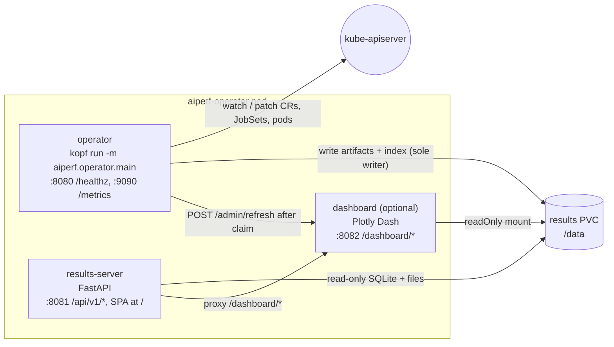
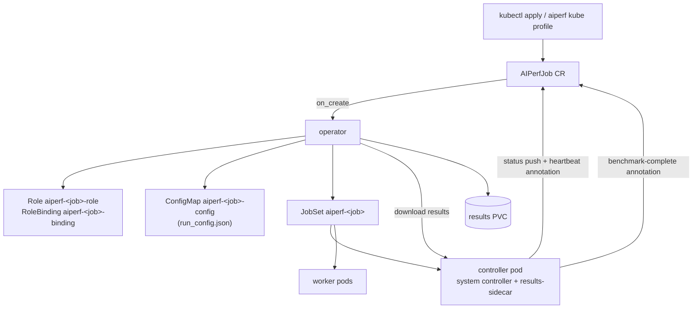
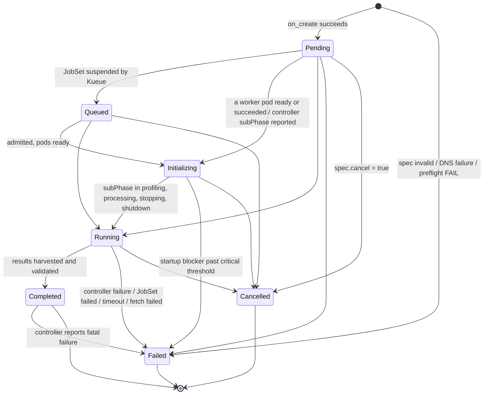
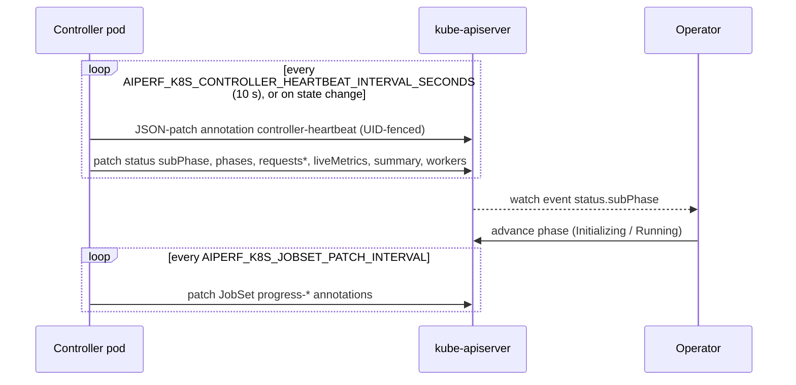
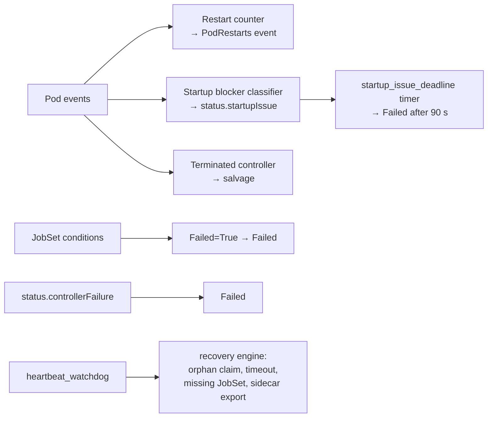
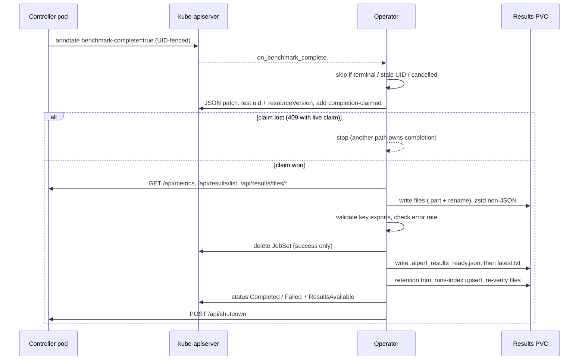
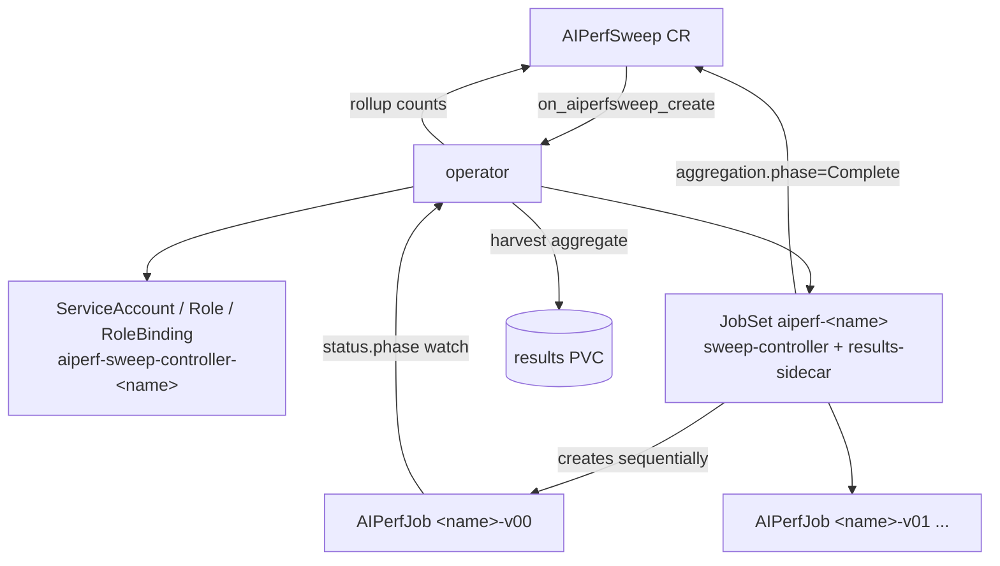

# AIPerf Operator Reference

The AIPerf operator is a [kopf](https://kopf.readthedocs.io/)-based Kubernetes
controller that turns `AIPerfJob` and `AIPerfSweep` custom resources into
running benchmarks, watches them, collects their results onto a persistent
volume, and serves those results over HTTP. This page explains how the operator
works: what it creates, which phases and conditions it writes, how it detects
failures, how completion and result harvesting are made exactly-once, and every
knob that tunes that behavior.

If you only want to run a benchmark, start with
[Getting Started on Kubernetes](getting-started.md). For CR field syntax see the
[Configuration Reference](configuration.md); for the HTTP endpoints see the
[Results Server API Reference](results-api.md).

---

## At a Glance

| | |
|---|---|
| CRDs | `aiperfjobs.aiperf.nvidia.com` (short names `apj`, `aiperf`), `aiperfsweeps.aiperf.nvidia.com` (short name `aps`); both `v1alpha1`, namespaced, with a `status` subresource |
| Entry point | `kopf run -m aiperf.operator.main` |
| Handler modules | `src/aiperf/operator/handlers/` (`create`, `lifecycle`, `monitor`, `completion`, `cleanup`, `jobset_terminal`, `pod_restarts`, `sweep/`) |
| Replicas | Exactly 1. The chart refuses to render otherwise because the operator implements no leader election |
| Finalizer | `aiperf.nvidia.com/finalizer` |
| Persistent state | One results volume (default mount `/data`; a PVC, or an `emptyDir` when `storage.enabled=false`) holding result artifacts plus a SQLite runs index |
| Ports | `8080` kopf liveness, `8081` results API, `9090` Prometheus metrics, `8082` dashboard sidecar (optional) |

---

## Architecture

### Operator pod

The Helm chart deploys one `Deployment` with `strategy: Recreate` and up to three
containers sharing the results volume:



| Container | Process | Role |
|---|---|---|
| `operator` | `kopf run -m aiperf.operator.main --verbose` plus `--all-namespaces` or one `--namespace=<ns>` per `operator.watchNamespaces` entry, and `--liveness=http://0.0.0.0:8080/healthz` | Every kopf handler and timer. Starts a `prometheus_client` metrics server from the `@kopf.on.startup` hook. The **only writer** of the runs index. |
| `results-server` | `python -m aiperf.operator.results_server` | All `/api/v1/*` routes, the web SPA at `/`, and the `/dashboard/*` reverse proxy. Opens the runs index read-only. |
| `dashboard` | `python -m aiperf.operator.dashboard_server` | Only when `dashboard.enabled=true`. Builds Plotly dashboards from the PVC. Runs in its own container so a memory blow-up while plotting cannot OOM-kill the API. |

kopf owns the `operator` container's event loop and liveness endpoint, so the
HTTP API runs in a separate container rather than alongside kopf.

Why the results-server mounts the PVC read-write: the runs index uses SQLite in
WAL mode, and even a WAL reader has to create the `-shm` file. The server
enforces read-only access at the SQLite layer instead (`mode=ro` URI plus
`PRAGMA query_only=ON`). The dashboard mounts the volume `readOnly: true`.

All containers run with `runAsNonRoot` (uid/gid 1000), `readOnlyRootFilesystem`,
all capabilities dropped, and seccomp `RuntimeDefault`. See
[RBAC and Security](rbac-security.md) for the ClusterRole catalog.

### What a benchmark looks like



The operator never runs benchmark traffic itself. It provisions a
[JobSet](https://jobset.sigs.k8s.io/), and the controller pod inside that JobSet
pushes progress straight onto the CR. The operator mostly **reacts to watch
events**; it does not poll the controller on a fixed timer. See
[Kubernetes Flow End-to-End](../dev/kubernetes-flow.md) for the in-pod
architecture (ZMQ topology, dataset transfer, credit channels).

### Handler map

Every handler is gated with `when=owns_namespace` (see
[Namespace scoping](#namespace-scoping-and-multiple-operators)) and wrapped with
`@track_handler` for [Prometheus metrics](#prometheus-metrics).

| Handler | Trigger | Resource |
|---|---|---|
| `on_create` | `@kopf.on.create` | AIPerfJob |
| `on_delete` | `@kopf.on.delete` (finalizer) | AIPerfJob |
| `on_cancel` | `@kopf.on.update`, field `spec.cancel` | AIPerfJob |
| `on_timeout_update` | `@kopf.on.update`, field `spec.timeoutSeconds` | AIPerfJob |
| `on_benchmark_complete` | `@kopf.on.update`, annotation `aiperf.nvidia.com/benchmark-complete: "true"` | AIPerfJob |
| `on_aiperfjob_phase_transition` | `@kopf.on.field` `status.phase` | AIPerfJob (also drives the sweep rollup) |
| `on_controller_subphase` | `@kopf.on.field` `status.subPhase` | AIPerfJob |
| `on_controller_failure` | `@kopf.on.field` `status.controllerFailure` | AIPerfJob |
| `startup_issue_deadline` | `@kopf.timer`, every `AIPERF_OPERATOR_MONITOR_INTERVAL` | AIPerfJob |
| `heartbeat_watchdog` | `@kopf.timer`, every `AIPERF_OPERATOR_MONITOR_INTERVAL` | AIPerfJob |
| `cleanup_old_results` | `@kopf.timer`, every `AIPERF_RESULTS_CLEANUP_INTERVAL_SECONDS` | AIPerfJob |
| `on_pod_container_status_change` | `@kopf.on.event` on pods labeled `jobset.sigs.k8s.io/jobset-name` | Pod |
| `on_jobset_conditions` | `@kopf.on.field` `status.conditions` | JobSet |
| `on_jobset_replicated_jobs_status` | `@kopf.on.field` `status.replicatedJobsStatus` | JobSet |
| `on_aiperfsweep_create` | `@kopf.on.create` | AIPerfSweep |
| `on_aiperfsweep_cancel` | `@kopf.on.update`, field `spec.cancel` | AIPerfSweep |
| `on_aiperfsweep_ttl_update` | `@kopf.on.update`, field `spec.ttlSecondsAfterFinished` | AIPerfSweep |
| `on_aiperfsweep_aggregation_complete` | `@kopf.on.resume` and `@kopf.on.field` `status.aggregation.phase == Complete` | AIPerfSweep |
| `on_aiperfsweep_delete` | `@kopf.on.delete` | AIPerfSweep |
| `cleanup_old_sweeps` | `@kopf.timer`, every `AIPERF_OPERATOR_MONITOR_INTERVAL` | AIPerfSweep |

Startup hooks: `configure` (finalizer name, event posting level, metrics
server), `claim_watched_namespaces`, and `open_runs_index` (which also starts
the sweep results retention loop). The `@kopf.on.login` hook
`login_for_apiserver_proxy` uses kopf's standard login, except when the
test-only `AIPERF_K8S_APISERVER_TLS_SERVER_NAME_OVERRIDE` is set, in which case
it disables kopf's TLS verification. Leave that variable unset in production. On shutdown, `close_runs_index` stops
namespace claims, cancels the retention loop, and closes the index.

Pod watching deliberately uses `@kopf.on.event` rather than `@kopf.on.field`.
Field handlers make kopf write a diff-base annotation onto the watched object,
which would require `pods: patch`, a permission the operator does not hold in
benchmark namespaces.

---

## AIPerfJob Lifecycle

### Phases



| Phase | Meaning | Written by |
|---|---|---|
| `Pending` | Child resources created; waiting for pods | `on_create` |
| `Queued` | JobSet carries a `kueue.x-k8s.io/queue-name` label and is `spec.suspend: true` | monitor reconcile |
| `Initializing` | At least one worker pod ready or succeeded, or the controller has started reporting a `subPhase` | JobSet progress handler, `on_controller_subphase` |
| `Running` | Controller `subPhase` is `profiling`, `processing`, `stopping`, or `shutdown` | `on_controller_subphase` |
| `Completed` | Result files downloaded and validated (a runs-index failure only sets `IndexUpdated=False`) | completion handler |
| `Failed` | Any terminal error; `status.error` carries the reason | many (see [Failure detection](#failure-detection)) |
| `Cancelled` | User set `spec.cancel: true` | `on_cancel` |

Phases only move forward. `Completed`, `Failed`, and `Cancelled` are terminal,
and entering a terminal phase clears `status.currentPhase` and `status.subPhase`.
The single exception: a controller-reported fatal failure
(`status.controllerFailure`) may overwrite `Completed` with `Failed`.

### Creation

`on_create` runs these steps in order. Every step after validation checks
whether the job has been cancelled before it continues.

1. **Same-name recreation fencing.** Any sticky cancel flag left by a deleted CR
   with the same name is cleared. In-process state is keyed by
   `<namespace>/<name>@<uid>`, so a recreated job never inherits the old one's
   state.
2. **Created already cancelled.** If `spec.cancel: true` at creation, the job
   goes straight to `Cancelled`.
3. **Spec validation.** The spec is validated as an `AIPerfJobSpec`. On failure:
   `ConfigValid=False` (reason `SpecInvalid`), phase `Failed`, and a permanent
   error, so kopf stops retrying. On success: `ConfigValid=True`.
4. **Endpoint probe** (skipped when there is no URL or when
   `spec.skipEndpointCheck: true`). The probe tries `/health`, `/v1/health`,
   `/v1/models`, then `/`. Any HTTP status below 500 counts as reachable.
   - DNS failure (after `AIPERF_ENDPOINT_CHECK_DNS_RETRIES` attempts) is
     **fatal**: `EndpointReachable=False/EndpointDNSResolutionFailed` and phase
     `Failed`.
   - Any other unreachability is **non-fatal**:
     `EndpointReachable=False/EndpointUnreachable` plus a Warning event, and
     creation continues. This lets you deploy a benchmark before the endpoint
     finishes rolling out.
5. **Build the run.** The spec is converted to a `BenchmarkRun` and the worker
   count is computed. The run identity (`RunMeta`: epoch, job name, namespace)
   is frozen here from `metadata.creationTimestamp`. Every pod later reads this
   same serialized run, so seeds and artifact paths match across pods.
6. **Credential transport check.** Endpoint credentials must reach pods through
   Secret-backed env vars (`valueFrom.secretKeyRef`). `api_key` needs
   `AIPERF_INJECTED_API_KEY` or `OPENAI_API_KEY`, sensitive headers need
   `AIPERF_INJECTED_HEADERS`, and URLs with userinfo or sensitive query
   parameters need `AIPERF_INJECTED_ENDPOINT_URLS`. A plaintext credential fails the job.
7. **Preflight.** Cluster checks run under a total budget of
   `AIPERF_PREFLIGHT_TIMEOUT` (see [Operator preflight](#operator-preflight)).
   Any FAIL leads to `PreflightPassed=False` and phase `Failed`. WARNs set
   `PreflightHasWarnings=True` and post one `PreflightWarning` event each.
8. **Role + RoleBinding** `aiperf-<job>-role` / `aiperf-<job>-binding`, bound
   to `podTemplate.serviceAccountName` (or `default`). This grants the benchmark
   pods read access to AIPerfJobs, pods, pod logs, ConfigMaps,
   Services/Endpoints, Events, and Jobs, plus `patch` on `aiperfjobs`,
   `aiperfjobs/status`, and `jobsets` so the controller can push status. The
   rules carry no `resourceNames`, so they apply to **every** such object in
   the namespace, not just this job's. Isolate untrusted tenants by namespace.
9. **ConfigMap** `aiperf-<job>-config` with a single key, `run_config.json`.
   Credentials are redacted during serialization and the size is checked
   against the 1 MiB ConfigMap limit. The operator then waits
   `AIPERF_CONFIGMAP_PROPAGATION_DELAY_SECONDS` (default 10 s) so the kubelet's
   ConfigMap cache does not race the pod mount (`FailedMount`).
10. **Persist before launch.** A redacted `job_spec.json` is written to the
    results directory and a row is inserted into the runs index. Both happen
    before the JobSet exists, so a restarted operator can always rebuild state
    for any running job.
11. **JobSet** `aiperf-<job>`. It is created `suspend: true` when a Kueue queue
    resolves. Its `ttlSecondsAfterFinished` comes from the CR's
    `spec.ttlSecondsAfterFinished` (default 300), and is omitted when
    `keepFailedPods: true`.
12. **Success.** The operator sets `ResourcesCreated=True`, phase `Pending`, and
    the `startTime`, `jobId`, `jobSetName`, `workers.{ready,total}`, and
    `observedGeneration` fields.

Every child object carries a controller `ownerReference` to the AIPerfJob with
`blockOwnerDeletion: true`. The operator creates no Services or Secrets; the
JobSet controller creates the headless Service through
`network.enableDNSHostnames`.

**Idempotent creates.** A `409 AlreadyExists` on any child is resolved by
reading the existing object:

| Existing object | Result |
|---|---|
| Owned by this exact CR UID, not terminating | Adopted |
| Owned by an older CR with the same name (different UID), or terminating | Retry after `AIPERF_OPERATOR_RECONCILE_CREATE_HARVEST_RETRY_DELAY_SECONDS` (30 s) until garbage collection removes it |
| Controlled by a foreign owner, or by no controller at all | Permanent `Failed` (never adopted) |

**Cancellation during creation.** If the JobSet already exists when a cancel
arrives, `on_create` deletes it itself, using a UID-fenced delete. `on_cancel`
cannot do this because it has not yet seen a `jobSetName`.

### Status reference

| Key | Content |
|---|---|
| `phase`, `error` | Lifecycle phase and terminal error text |
| `observedGeneration` | Last spec generation the operator acted on |
| `jobId`, `jobSetName` | Job ID (equals the CR name, max 35 chars) and JobSet name |
| `startTime`, `completionTime` | RFC 3339 timestamps |
| `subPhase` | Controller system state: `initializing`, `configuring`, `ready`, `profiling`, `processing`, `stopping`, `shutdown` |
| `currentPhase`, `phases` | Current credit phase (warmup/profiling) and per-phase progress |
| `requestsCompleted`, `requestsTotal`, `requestsPerSecond` | Live request progress |
| `workers` | `{ready, total}` from the operator until the controller takes over with `dispatchable`, `routerConnected`, `readyRecordProcessors`, `declaredRecordProcessors`, `readyPods`, `totalPods`, `degradedPods` |
| `liveMetrics`, `liveSummary`, `serverMetrics` | Live metric snapshots pushed by the controller |
| `summary` | Live values during the run (feeds printer columns); final metrics after completion |
| `results`, `resultsPath`, `runEpoch` | Harvested files, their on-PVC path, and the run's epoch key |
| `resultsTtlDays` | Copied from the spec for the results-TTL timer |
| `startupIssue` | The current pod startup blocker (see below) |
| `conditions` | See [Conditions](#conditions) |

`kubectl get aiperfjob` shows Phase, Stage, Done, Total, QPS, TPS, TTFT, ITL,
E2E, and Age. `-o wide` adds P99, E2E P99.9, and average latency columns.

### Conditions

Conditions use `"True"`/`"False"` status strings. `lastTransitionTime` changes
only when the status flips.

| Type | True when | False reasons |
|---|---|---|
| `ConfigValid` | Spec validated (`SpecValid`) | `SpecInvalid` |
| `EndpointReachable` | Probe succeeded | `EndpointDNSResolutionFailed`, `EndpointUnreachable` |
| `PreflightPassed` | No FAILing check | `PreflightFailed` |
| `PreflightHasWarnings` | At least one WARN (`PreflightWarnings`) | `NoWarnings` |
| `ResourcesCreated` | Role, ConfigMap, and JobSet exist | n/a |
| `WorkersReady` | Worker pods ready (`WorkersReady`), or backfilled at completion (`CompletedBeforeMonitor`) | `WorkersStarting`, `PodStartupBlocked`, `SchedulingDelayed`, `PodStartupFailed` |
| `BenchmarkRunning` | Backfilled as `CompletedBeforeMonitor` for runs too fast to observe | n/a |
| `ResultsAvailable` | `ResultsStored`, `PartialCheckpointRecovered`, `PartialLiveMetricsRecovered` | `ResultsFetchFailed`, `ControllerTerminated` |
| `IndexUpdated` | n/a | `IndexUpdateFailed` (results are still on disk) |
| `Complete` | Phase `Completed` **and** `ResultsAvailable=True` (`ResultsStored`) | `JobFailed`, `JobCancelled` |
| `Failed` | Phase `Failed` (`JobFailed`) | `JobCompleted`, `JobCancelled` |

`Complete` and `Failed` mirror the `batch/v1` Job conventions, so these work
just as they do for a Job:

```bash
kubectl wait --for=condition=Complete aiperfjob/my-bench --timeout=2h
kubectl wait --for=condition=Failed   aiperfjob/my-bench --timeout=2h
```

A cancelled job sets **both** to `False` with reason `JobCancelled`.

### Events

The operator posts Kubernetes Events (`kubectl describe aiperfjob <name>`) with
these reasons:

| Reason | Type | When |
|---|---|---|
| `SpecValid` / `SpecInvalid` | Normal / Warning | Spec validation |
| `EndpointReachable` / `EndpointUnreachable` | Normal / Warning | Endpoint probe |
| `PreflightPassed` / `PreflightFailed` / `PreflightWarning` | Normal / Warning / Warning | Preflight |
| `ResourcesCreated`, `Created` | Normal | Creation succeeded |
| `PodStartupBlocked` | Warning | A startup blocker has been stable for `AIPERF_K8S_WATCHDOG_PENDING_THRESHOLD_SECONDS` |
| `PodRestarts` | Warning | A container reached `AIPERF_POD_RESTART_THRESHOLD` restarts (once per pod and restart count) |
| `JobTimeout` | Warning | `timeoutSeconds` exceeded |
| `ResultsStored` / `ResultsFailed` | Normal / Warning | Result harvest |
| `IndexUpdateFailed` | Warning | Runs-index write failed |
| `Completed`, `Failed`, `Cancelled` | Normal / Warning / Warning | Terminal transitions |
| `ShutdownSignalFailed` | Warning | `POST /api/shutdown` to the controller failed (non-fatal) |
| `ResultsCleaned` | Normal | The results TTL removed expired runs |

Event posting is best-effort. A failed post never fails a handler.

### Cancellation

Cancel a job by setting `spec.cancel: true`, either with
`aiperf kube cancel`, through `POST /api/v1/jobs/{ns}/{name}/cancel`, or with
`kubectl patch aiperfjob <name> --type=merge -p '{"spec":{"cancel":true}}'`.

`on_cancel` runs these steps:

1. Re-reads the CR and skips the callback if the UID has changed.
2. Sets a sticky in-process cancel flag. From then on, every monitor tick and
   completion path short-circuits for this job.
3. Deletes the JobSet. The delete only proceeds when the JobSet's controller
   `ownerReference` matches this exact CR (`apiVersion`, `kind`, `name`, `uid`),
   and it is issued with a UID precondition.
4. Closes the progress client and sets `Cancelled` with `completionTime`.

If the fenced delete is abandoned (for example, the JobSet now belongs to
someone else), the cancel flag is revoked. Otherwise every later tick would
short-circuit forever, and the `spec.cancel` watcher would never fire again for
an unchanged value.

The final `Cancelled` status patch is intentionally **not**
resourceVersion-fenced. A conflicting concurrent write would otherwise drop the
patch after the JobSet is already gone and strand the CR in `Running`.

### Timeouts

`spec.timeoutSeconds` is the only mutable benchmark-shaping field;
`on_timeout_update` acknowledges a change by stamping `observedGeneration`. The
effective limit is `spec.timeoutSeconds`, or `AIPERF_JOB_TIMEOUT_SECONDS` when
the spec value is `0` (the CRD default), measured from `status.startTime`. A
value of `0` in both places means no timeout.

On expiry, the watchdog deletes the JobSet, sets `Failed` with
`Job timed out after Ns (limit: Ms)`, and posts `JobTimeout`. Enforcement is
deferred while either of these holds:

- A completion claim younger than `AIPERF_COMPLETION_CLAIM_TRUST_WINDOW_SECONDS`
  exists.
- `status.resultsExported` is set, meaning the run finished and is only
  draining.

### Deletion and TTLs

Deleting an AIPerfJob triggers `on_delete` through the finalizer, which:

1. Sets the cancel flag and closes the progress client.
2. Makes a best-effort, UID-fenced JobSet delete, so pod teardown starts
   immediately instead of waiting for garbage collection.
3. Removes every runs-index row for the job.

The ConfigMap, Role, and RoleBinding are removed by owner-reference garbage
collection. **Results on the PVC are not deleted**; they remain browsable
through the results API until a retention policy removes them.

Three independent lifetimes apply:

| Setting | Applies to | Default |
|---|---|---|
| `spec.ttlSecondsAfterFinished` | The **JobSet** and its pods (enforced by the JobSet controller); not set at all when `keepFailedPods: true` | 300 s |
| `spec.resultsTtlDays` / `AIPERF_RESULTS_TTL_DAYS` | Result epochs on the PVC | 30 days. The spec accepts 1-365; only the env var accepts `0` (never) |
| `AIPERF_RESULTS_RETAIN_RUNS` / `AIPERF_RESULTS_RETAIN_DAYS` | Count/age trim per job after each completion | 10 runs / disabled |

The operator does not delete AIPerfJob CRs on its own. AIPerfSweep CRs are
different: see [Sweep cleanup](#cancel-ttl-delete).

---

## Progress Reporting

The controller pod pushes progress; the operator does not poll for it.



- **CR status push.** The controller writes only `subPhase`, `phases`,
  `currentPhase`, `requestsCompleted`, `requestsTotal`, `requestsPerSecond`,
  `liveMetrics`, `liveSummary`, `summary`, `serverMetrics`, `workers`,
  `resultsExported`, and `controllerFailure`. Every other status key (`phase`,
  `error`, `conditions`, `results*`, `runEpoch`, `startupIssue`) belongs to the
  operator. The controller pushes at least once per heartbeat interval, and
  immediately on bus events (state change, phase progress, results exported,
  service error).
- **Identity fencing.** Annotation patches carry an atomic
  `test /metadata/uid` op. Status pushes re-read the CR and compare the UID
  first, then send a phase-tested JSON patch. Before any phase exists they
  send a merge patch instead, or an untested JSON patch when `serverMetrics` is
  included. Once the CR is terminal, pushes stop. Either way, a controller left over from a deleted CR does not
  write to a new CR that reuses its name.
- **Heartbeat.** The annotation `aiperf.nvidia.com/controller-heartbeat` holds
  an RFC 3339 timestamp. The [heartbeat watchdog](#heartbeat-watchdog-and-recovery-engine)
  treats it as stale after `AIPERF_K8S_CONTROLLER_HEARTBEAT_EXPIRY_SECONDS`
  (30 s; must be at least 2× the interval).
- **JobSet annotations.** `aiperf.nvidia.com/progress-phase`,
  `progress-percent`, `progress-requests`, `progress-status`, and
  `system-state` are written to the JobSet and mirrored onto the AIPerfJob.
  They are patched only when their value changes. Before any credit phase
  exists, only `progress-status=initializing` and `system-state` are written.
  `progress-phase` appears once a phase exists. `progress-percent` and
  `progress-requests` appear once a percentage or a positive total is known.
- **Operator writes.** The operator converts JobSet `replicatedJobsStatus` into
  `status.workers` (scaled by workers per pod) until the controller's richer
  `workers` object appears; the presence of `totalPods` marks the controller
  takeover. It also advances phases from `subPhase`.

Every event-driven status write the operator makes is a JSON patch with `test`
ops on `/metadata/uid`, `/metadata/resourceVersion`, and `/status/phase`. A
409/422 conflict retries after
`AIPERF_OPERATOR_RECONCILE_CONFLICT_RETRY_DELAY_SECONDS`, so two writers never
silently clobber each other.

The operator also calls these controller endpoints on
`<jobset>-controller-0-0.<jobset>.<ns>.svc.cluster.local`:

| Port | Endpoint | Used for |
|---|---|---|
| 9090 (API) | `GET /api/progress` | Orphan-claim recovery gate and final phase re-sampling |
| 9090 (API) | `GET /api/metrics` | Final metrics during result fetch |
| 9090 / 9091 (sidecar) | `GET /api/results/list`, `GET /api/results/files/<path>` | Result discovery and download |
| 9090 (API) | `POST /api/shutdown` | Release the controller after harvest |

The JSON `GET` calls (`/api/progress`, `/api/metrics`, `/api/results/list`)
retry on 408, 429, 500, 502, 503, and 504 with exponential backoff
(`AIPERF_OPERATOR_PROGRESS_*`). `POST /api/shutdown` and individual file
downloads are sent once, with no retry; the result fetch loop retries
downloads as a whole.

---

## Failure Detection



### Pod restarts

When any regular container (`containerStatuses`; init and native sidecar
containers are not counted) in a JobSet pod reaches `AIPERF_POD_RESTART_THRESHOLD`
restarts (default 3), the operator follows the owner chain Pod → Job → JobSet →
AIPerfJob, checking the owner UID at every hop. It then posts one `PodRestarts`
Warning per pod and restart count. The message carries the waiting reason or
the last termination reason (for example `OOMKilled`).

This detector **only posts an event**; it never changes the phase.

### Startup blockers

Each pod event is classified for blockers that stop startup:

| Waiting reason | Category | Can fail the job? |
|---|---|---|
| `ErrImagePull`, `ImagePullBackOff`, `ErrImageNeverPull`, `InvalidImageName` | `ImagePull` | Yes |
| `CreateContainerConfigError`, `CreateContainerError`, `RunContainerError` | `ContainerConfig` | Yes |
| `CrashLoopBackOff` | `CrashLoop` | Only once `restartCount >= AIPERF_K8S_WATCHDOG_CRASHLOOP_RESTART_THRESHOLD` (2) |
| `PodScheduled=False`, reason `Unschedulable`, with a structural message (node selector/affinity mismatch, untolerated taint, volume node-affinity conflict) and no capacity signal | `SchedulingConstraint` | Yes |
| Any other `Unschedulable` message, including any that mentions capacity (`Insufficient cpu`, too many pods, unbound PVC, ...) even alongside a structural mismatch | `SchedulingDelay` | **Never**; it may simply be waiting for capacity |

The highest-priority blocker is recorded in `status.startupIssue`, with these
fields: `fingerprint` (`category:pod:container`), `podName`, `containerName`,
`reason`, `message`, `category`, `terminalAfterThreshold`, `firstObservedTime`,
and `warningEmitted`.

What happens next depends on how long the same blocker stays in place:

1. **First observation.** The operator writes `status.startupIssue` and sets
   `WorkersReady=False` right away. The reason is `PodStartupBlocked` when the
   blocker can become terminal. It is `SchedulingDelayed` when it cannot: a
   capacity delay, or a crash loop still below the restart threshold.
   **Stable for `AIPERF_K8S_WATCHDOG_PENDING_THRESHOLD_SECONDS` (30 s):** it
   posts one `PodStartupBlocked` Warning event.
2. **Terminal-capable and stable for
   `AIPERF_K8S_WATCHDOG_PENDING_CRITICAL_THRESHOLD_SECONDS` (90 s).** The
   `startup_issue_deadline` timer fails the job in three steps:
   1. Atomically claims the failure with annotation
      `aiperf.nvidia.com/startup-failure-claimed=<fingerprint>`. This annotation
      and the completion claim are mutually exclusive.
   2. Deletes the JobSet.
   3. Sets `Failed`, with `WorkersReady=False/PodStartupFailed`.
3. **Blocker clears.** `startupIssue` is reset to `null` and the condition
   returns to `WorkersStarting`.

The deadline timer only ages the cached `startupIssue`; it never lists pods.

### JobSet failure

A newly appearing JobSet `Failed=True` condition is handled as follows:

- The **controller** replicated job failed: the AIPerfJob is set to `Failed`
  with the condition message.
- Only **workers** failed: logged as non-fatal. It escalates to `Failed` only
  if the controller has also stopped (`active == 0` and `succeeded == 0`).
- Neither replicated job reports a failure, so the failing scope cannot be
  determined: treated as fatal, and the job is set to `Failed`.

A JobSet `Completed` condition is **deliberately ignored**. A process exiting
is not proof that the controller finished its durable results handshake; only
the completion annotation or verified exports complete a job.

### Controller-reported failure

When the controller writes `status.controllerFailure`, the operator sets
`Failed` with `Controller reported fatal failure: <msg>`. This is the only path
allowed to override `Completed`.

### Heartbeat watchdog and recovery engine

The `heartbeat_watchdog` timer runs every `AIPERF_OPERATOR_MONITOR_INTERVAL`
(10 s) and does nothing for terminal jobs. It escalates to the full recovery
engine only when the heartbeat is stale **or** a timeout is due. Heartbeat age
is measured from the annotation, falling back to `creationTimestamp` and then
`status.startTime`.

The recovery engine runs these steps in order:

1. **Orphan claim recovery.** The `completion-claimed` annotation exists but
   the phase is still non-terminal. Typically this means an operator crashed
   mid-harvest. The engine resumes the harvest under the existing claim (it
   does not claim again), but only if there is evidence the benchmark actually
   finished: `/api/progress` reports complete, the control-plane container has
   terminated, or the JobSet has completed, failed, or vanished. Recovering a
   still-running benchmark would race the exporter into a stagnation loop.
2. **Timeout** (see [Timeouts](#timeouts)).
3. **Missing JobSet.** If the JobSet returns 404, the engine waits
   `AIPERF_OPERATOR_MONITOR_MISSING_JOBSET_SETTLE_DELAY_SECONDS` (2 s), re-reads
   the CR, and only then sets `Failed: JobSet not found`. This is skipped while
   a trusted completion claim exists. If the re-read fails, the decision is
   deferred to the next tick rather than failing the job.
4. **Kueue suspension** moves the job to `Queued`. The engine also handles JobSet
   failure conditions, worker counts, and a pod startup scan.
5. **Terminated controller salvage.** A non-sidecar container in the controller
   pod exited non-zero before exporting. This step needs a `results-sidecar`
   container to exist, and is skipped when `status.controllerFailure` is
   already set. The engine claims completion, then runs the normal fetch: API
   port 9090, then the sidecar on 9091, then files already on disk. The
   outcome depends on what was recovered:

   | Recovered | Phase | `ResultsAvailable` |
   |---|---|---|
   | Any final export files | Normal completion path: `Completed`, or `Failed / ResultsFetchFailed` if key exports are missing | as in [Validating and publishing](#validating-and-publishing) |
   | No final files, checkpoint files | `Failed` | `True / PartialCheckpointRecovered` |
   | No final files, only live metrics | `Failed` | `True / PartialLiveMetricsRecovered` |
   | Nothing | `Failed` | `False / ControllerTerminated` |
6. **Sidecar export recovery.** While the job is `Initializing` or `Running`,
   if key exports are listed on the sidecar but no completion annotation ever
   arrived, the engine claims and harvests them.

Transient errors raise a kopf `TemporaryError` after
`AIPERF_OPERATOR_RECONCILE_PERSISTENCE_RETRY_DELAY_SECONDS`. On every exception
path the handler clears its pending kopf patch. A stale patch would otherwise
409 and permanently stop the timer for that object.

---

## Completion and Result Harvesting

Completion must happen exactly once, even with operator restarts, multiple
detection paths, and user-editable annotations.



### Detection

The normal path: the controller sets annotation
`aiperf.nvidia.com/benchmark-complete: "true"` with a UID-fenced JSON patch.
`on_benchmark_complete` checks for cancellation **before** claiming. A claim
stamped after `on_delete` would be lost to garbage collection.

Terminated-controller salvage and sidecar export recovery also claim before
downloading. Orphan claim recovery is the exception: it does not claim again,
but resumes the harvest under the claim that already exists.

### The durable completion claim

`try_claim_completion` writes annotation `aiperf.nvidia.com/completion-claimed`
(an RFC 3339 timestamp) with an RFC 6902 JSON patch whose `test` ops pin
`/metadata/uid` and `/metadata/resourceVersion`. Concurrent claimants race
atomically on the apiserver; exactly one wins.

| Patch outcome | Meaning |
|---|---|
| Success | Claim won; this path owns harvesting |
| 409, live re-read shows a claim | Race lost (counted in `aiperf_operator_completion_claim_races_total`) |
| 409 without a live claim, or 422 | Not claimed; a later tick retries |
| A live `startup-failure-claimed` annotation | Claim refused |

An in-process set acts as a fast path, but the CR annotation is
authoritative. The annotation can be edited by any user with AIPerfJob write
access, so a claim only suppresses timeout and missing-JobSet failures for
`AIPERF_COMPLETION_CLAIM_TRUST_WINDOW_SECONDS` (900 s). The window is
intentionally not derived from `timeoutSeconds`, because draining results can
outlast a short benchmark deadline.

Winning a claim also sends a fire-and-forget `POST /admin/refresh` to the
dashboard sidecar, when it is enabled.

### Fetching results

Results go to `<AIPERF_RESULTS_DIR>/<namespace>/<job>/<epoch>/`. Each attempt
runs these steps:

1. `GET /api/metrics` on the controller API port. It is retried on each
   attempt until it succeeds; after that the payload is cached.
2. List and download all result files from the API port (9090).
3. If no key export arrived, repeat from the `results-sidecar` port (9091).
   The sidecar outlives the control-plane process, which lets salvage work
   even when the API port is gone.
4. Succeed if any key export (for example `profile_export_aiperf.json`) is
   present; otherwise retry.

Download behavior:

- Up to `AIPERF_RESULTS_DOWNLOAD_MAX_CONCURRENCY` (5) files download in
  parallel, each with an `AIPERF_RESULTS_DOWNLOAD_TIMEOUT_SECONDS` (300 s)
  total timeout.
- Files are written to `.part` and atomically renamed into place.
- Listed names containing path traversal are skipped. An unsafe `X-Filename`
  header is ignored, and the file is saved under its listed name.
- With `AIPERF_RESULTS_COMPRESS_ON_DISK=true` (default), non-JSON files are
  stored as `<name>.zst`. zstd responses pass through without recompression.
  `.json` files stay raw so they remain greppable.

Retry is **progress-aware**. Backoff starts at `AIPERF_RESULTS_RETRY_DELAY`
(2 s), multiplies by `AIPERF_RESULTS_RETRY_BACKOFF_MULTIPLIER` (2), is capped
at `AIPERF_RESULTS_RETRY_MAX_DELAY_SECONDS` (30 s), and has ±20% jitter. The
fetch gives up only after `AIPERF_RESULTS_MAX_RETRIES` (5) consecutive attempts
in which on-disk bytes did **not** grow. A large, slow transfer keeps retrying
for as long as it makes progress.

### Validating and publishing

The completion handler runs these steps:

1. **Error-rate gate.** A run whose files exist is not necessarily a success:
   an all-error run still writes its JSON export. The run fails when its error
   rate reaches `AIPERF_K8S_DIAGNOSIS_FAIL_ABOVE_ERROR_RATE` (default `1.0`,
   meaning only a 100% error run fails).
2. **Materialization check.** A key file counts only if it is non-empty, a
   complete zstd frame (where compressed), and, for JSON, parses to a non-empty
   object. Truncated (ENOSPC) or empty exports are rejected.
3. **Transient retry budget.** If key files are missing but the failure looks
   transient and the claim is younger than
   `AIPERF_RESULTS_TRANSIENT_FETCH_RETRY_BUDGET_SEC` (60 s), the handler raises
   a kopf `TemporaryError` (retry after
   `AIPERF_RESULTS_TRANSIENT_FETCH_RETRY_DELAY_SEC`) **before** writing any
   terminal status.
4. **Final phase settle.** The handler re-samples `/api/progress` up to
   `AIPERF_RESULTS_PHASE_SETTLE_ATTEMPTS` (3) times,
   `AIPERF_RESULTS_PHASE_SETTLE_DELAY_SEC` apart, so `status.phases` shows the
   final counts.
5. **Delete the JobSet, on success only.** On failure the pods are kept so you
   can inspect them.
6. **Publish to the PVC.** Write `.aiperf_results_ready.json`, **then** update
   `latest.txt`; this ordering is load-bearing for readers. Next, trim
   retention (the current epoch is never deleted) and upsert the runs index.
   Finally, re-verify the artifact fingerprints. If files vanished in the
   meantime, the run is demoted to a failure and its marker and index row are
   removed.
7. **Write terminal status:**

   | Outcome | Phase | Condition | Events |
   |---|---|---|---|
   | Success | `Completed` | `ResultsAvailable=True/ResultsStored` | `ResultsStored`, `Completed` |
   | Files present but error rate over threshold | `Failed` (`Benchmark failed: X% of requests errored`) | `ResultsAvailable=True/ResultsStored` | `ResultsStored`, `Failed` |
   | Fetch failed | `Failed` | `ResultsAvailable=False/ResultsFetchFailed` | `ResultsFailed` |

`ResultsStored` is posted whenever key files were materialized, regardless of
the final phase.

**Shutdown.** The completion handler does not stop the controller itself.
After a completion triggered by the annotation, `on_benchmark_complete` sends
`POST /api/shutdown` to release the controller, best-effort. A transport
exception posts a `ShutdownSignalFailed` Warning event. A non-2xx reply, or a
connection error handled inside the client, is only logged. Orphan claim
recovery also sends the shutdown and only logs failures. In no case is the
completion result affected.

The final completion status patch is not resourceVersion-fenced, for the same
reason as cancellation: a concurrent heartbeat write must not strand the CR in
`Running`.

---

## AIPerfSweep Handling

A sweep runs many benchmark variations. The operator does not expand the sweep
itself. Instead, it launches a **sweep-controller pod**, which creates one child
`AIPerfJob` per (variation, trial) and runs the same `MultiRunOrchestrator` used
by in-process sweeps. The user-facing guide is
[Running Sweeps on Kubernetes](../tutorials/sweeps.md#running-sweeps-on-kubernetes);
for Bayesian optimization see [Adaptive Search on Kubernetes](adaptive-search.md).



### Creation and limits

`on_aiperfsweep_create` runs these steps:

1. **Validate the spec**, including credential transport across every sweep
   axis. An invalid spec sets `phase=Failed` and `ConfigValid=False/SpecInvalid`
   on status. kopf's `PermanentError` alone would leave the status blank.
2. **Compute cardinality.** The variation count is first computed
   arithmetically, without expanding the sweep, so an oversized sweep is
   rejected cheaply. Expanding a million-variation grid would block the kopf
   event loop and get the pod killed by its liveness probe. A sweep that fits
   under the cap is then expanded, and its exact length becomes
   `totalVariations`; for adaptive search, `totalVariations` is
   `maxIterations`. `maxTotalRuns = totalVariations × multiRun.numRuns`.
3. **Enforce limits.** At most 200 variations and 10 trials. Child names are
   `<sweep>-v<NN>[-t<N>]` and must fit the 35-character job-ID limit, so long
   sweep names are rejected (reason `SweepRejected`, with a Warning event).
   The initial status is staged at this point: `phase=Pending`,
   `totalVariations`, `maxTotalRuns`, `completedRuns=0`, `failedRuns=0`,
   `runEpoch`, `startedAt`, and `apiUrl`.
4. **Provision RBAC.** ServiceAccount, Role, and RoleBinding are all named
   `aiperf-sweep-controller-<name>`. The Role grants:
   - create/get/list/watch/patch/update/delete on `aiperfjobs` and
     `aiperfjobs/status`, across the whole namespace (no `resourceNames`);
   - get/patch/update on this one sweep and its status;
   - create/patch on `events`.
5. **Create the JobSet** `aiperf-<name>`, which runs
   `python -m aiperf.sweep_controller.main` with `AIPERF_OPERATOR_MANAGED=1`
   alongside a `results-sidecar`. Results live on an emptyDir and are
   harvested later.
   - When `podTemplate.resources` is unset and `resourceMode` is not `none`,
     resources come from the `AIPERF_K8S_SWEEP_CONTROLLER_*` defaults
     (75m / 512Mi). These are sized for the torch/BoTorch footprint of
     adaptive search.
6. **Add `runtimeRef`** (JobSet name and controller host) and
   `observedGeneration` to the staged status.

`AIPERF_OPERATOR_MANAGED=1` also makes the in-process CLI refuse to run its own
sweep, so the two layers never both sweep.

The sweep-controller creates children **one at a time** and
gets-or-creates each by its deterministic name, so a restarted controller
reuses children it already made. Each child carries:

- Labels `aiperf.nvidia.com/sweep`, `sweep-uid`, `sweep-run-epoch`,
  `variation-index`, `variation-label`, and `trial-index` when trials are used.
- A controller `ownerReference` to the sweep.
- Any `spec.childMetadata` labels and annotations; the tracking keys always
  win over user-supplied ones.

Child names either all carry the `-t<N>` trial suffix or all omit it. The
suffix is used when `multiRun.numRuns > 1` or convergence is configured.

The sweep-level fields are removed from the child spec: `sweep`, `multiRun`,
`failurePolicy`, `cancel`, `ttlSecondsAfterFinished`, `childMetadata`, and
`plot`. `variables` and `randomSeed` are replaced with the values resolved for
that variation.
Without this, the parent's TTL would reap children before harvest, and each
child would re-run the trial loop.

### Sweep phases and status

| Phase | Written by |
|---|---|
| `Pending` | Operator at create |
| `Running` | Sweep-controller when it starts (JSON patch, `test` that the phase is still `Pending`) |
| `Aggregating` | Operator rollup, once every owned child is terminal and `completed + failed + cancelled >= maxTotalRuns` |
| `Succeeded` / `PartiallyFailed` / `Failed` / `Cancelled` | Sweep-controller after aggregation; operator if the controller JobSet fails |

The terminal phase is chosen from these rules:

| Situation | Phase |
|---|---|
| Cancel requested | `Cancelled` |
| No child failures | `Succeeded` (or `Cancelled` when there are cancellations but zero successes) |
| `failurePolicy.maxFailures > 0` and failures reached that limit | `Failed` |
| Zero successes | `Failed` |
| `failurePolicy.onChildFailure: abort` | `Failed` |
| Otherwise | `PartiallyFailed` |

Cancelled children never count as failures.

**Rollup.** Each child `status.phase` transition triggers
`on_aiperfjob_phase_transition`. A child counts toward the rollup only if its
controller `ownerReference` (kind, name, uid) matches **and** all three tracking
labels match. The rollup patches the following fields:

- `completedRuns`, `failedRuns`
- `runStates.{pending,running,completed,failed,cancelled}`
- `lastChildEvent`
- `apiUrl`, re-stamped on every rollup
- `currentChildRef`: the child in a `running` bucket with the lowest index;
  otherwise the lowest-index child whose phase is exactly `Pending`. Children
  that are `Queued` or `Initializing` are never selected, so this field can be
  null while a child is starting up.

Child phases are bucketed into `runStates` like this:

| Child phase | Bucket |
|---|---|
| `Succeeded`/`Completed` | `completed` |
| `Failed`/`PartiallyFailed` | `failed` |
| `Cancelled` | `cancelled` |
| `Profiling`/`Processing`/`Running` | `running` |
| Anything else | `pending` |

Once the parent is terminal, the rollup stops patching the counts
(`completedRuns`, `failedRuns`, `runStates`, `lastChildEvent`), so children
reaped by their own TTL cannot zero out the final counts. It still appends
terminal children to `status.runs[]`.

On each terminal child, a compact entry is appended to `status.runs[]` through a
compare-and-swap patch (up to `AIPERF_OPERATOR_RECONCILE_RUNS_CAS_MAX_ATTEMPTS`).
An entry has `index`, `label`, `values`, `phase`, `childName`, `startedAt`,
`completedAt`, and `metrics`. Past 1,500 entries or about 350 KB, the operator
writes `status.runsTruncated{total,included,fetchURL}` instead, pointing at
`GET /api/v1/sweeps/{ns}/{name}/children`.

The sweep-controller owns `currentCell`, `aggregation`, `aggregateRef`,
`aggregate`, and the terminal phase and counts. `kubectl get aiperfsweep` shows
Phase, Completed, Total, Failed, Current (`currentCell.label`), and Age.

### Aggregation and harvest

When all children are terminal, the sweep-controller aggregates results into
`/results/<ns>/sweeps/<name>/<epoch>/`: `aggregate.json`, `children.json`,
`sweep_aggregate/`, and `search_history.json` (adaptive) or
`sampling_design.json` (QMC). It prunes non-canonical files, writes the ready
marker, and patches `aggregation.phase=Complete` together with a *live*
`aggregateRef` that points at its own sidecar.

That status change fires `on_aiperfsweep_aggregation_complete`. The same
handler is also registered with `@kopf.on.resume`, so an operator restart re-runs
it. It works in five stages:

1. **Identity gate.** The live CR's UID must still match, and JobSet
   `aiperf-<name>` must be absent or controlled by exactly this sweep UID.
   Stale callbacks are logged and skipped.
2. **Fetch.** If a previous pass already committed (`resultsAvailable` is set,
   `aggregateRef.url` is present, and `aggregate.json` parses on disk), the
   fetch is skipped and the handler goes straight to the idempotent commit and
   JobSet delete. Otherwise the aggregate tree is downloaded from the sidecar
   into `<AIPERF_RESULTS_DIR>/<ns>/sweeps/<name>/<epoch>/`.
3. **Branch on the outcome:**

   | Outcome | Action |
   |---|---|
   | Partial download (`downloaded < listed`) | Retry; keep the JobSet |
   | Nothing downloaded but files listed | Retry |
   | Nothing downloaded, no parseable `aggregate.json` on disk | Retry |
   | Nothing downloaded, parseable aggregate, harvest sentinel present | Already done: commit and delete the JobSet |
   | Nothing downloaded, parseable aggregate, no sentinel, JobSet still exists | Retry |
   | Nothing downloaded, parseable aggregate, no sentinel, JobSet gone | Legacy recovery: finalize from disk |
   | `aggregate.json` missing or unparseable after a download | Retry (a truncated file counts as absent) |
   | Full success | Continue to step 4 |

   Retries use `kopf.TemporaryError` with
   `AIPERF_OPERATOR_RECONCILE_CREATE_HARVEST_RETRY_DELAY_SECONDS` (30 s).
4. **Finalize.** CR status is merged into `aggregate.json`. Then the **harvest
   sentinel** `.aiperf_sweep_harvest_complete.json` is written atomically. A
   parseable `aggregate.json` alone could come from a partial harvest; the
   sentinel proves every advertised file landed.
5. **Commit, in this order:**
   1. Rewrite each child's sweep lineage marker from `children.json`.
   2. Publish the **durable** `aggregateRef`: a JSON patch with `test` on the
      UID, adding an `aggregateRef.url` that points at the operator's results
      API, plus `resultsAvailable: true`.
   3. Advance `latest.txt` (never backwards).
   4. Index the sweep.
   5. Delete the JobSet with a UID precondition. The controller exits 0 on
      success, but its sidecar keeps serving, so the operator has to remove it.

The presence of `aggregateRef.url` is how the TTL reaper and a restarted
controller tell a durable reference from the live one.

### Cancel, TTL, delete

- **Cancel** (`spec.cancel: true`). The operator adds a
  `Cancelling=True/UserRequested` condition. The sweep-controller polls the
  flag every `AIPERF_SWEEP_CONTROLLER_CANCEL_POLL_INTERVAL_SECONDS` (10 s),
  patches the in-flight child with `spec.cancel: true`, waits up to
  `AIPERF_SWEEP_CONTROLLER_CANCEL_GRACE_SECONDS` (120 s), and finishes as
  `Cancelled`.
- **TTL.** The `cleanup_old_sweeps` timer deletes a terminal sweep once
  `ttlSecondsAfterFinished` (default 300 s) has elapsed since `completionTime`.
  It never reaps while `aggregation.phase=Complete` but the durable ref is not
  yet published, even with a TTL of 0, so reaping cannot race the harvest.
  The delete carries a UID precondition.
- **Delete.** `on_aiperfsweep_delete` lists owned children (label selector
  plus ownership re-check) and patches each with `spec.cancel: true`, so
  children shut down cooperatively before cascade garbage collection removes
  them along with the JobSet and RBAC.

---

## Results Storage

### On-disk layout

```text
/data/                                    # AIPERF_RESULTS_DIR
  .aiperf_index.sqlite (+ -wal, -shm)     # runs index (cache, not source of truth)
  .aiperf_index.sqlite.broken-<unix>      # corrupt index set aside at startup
  .aiperf_index_complete                  # bootstrap finished marker
  .aiperf_index_pending/                  # per-run publication gates
  <namespace>/
    <job>/
      latest.txt                          # pointer to the current epoch
      <epoch>/
        job_spec.json                     # redacted CR spec
        .aiperf_results_ready.json        # ready marker
        profile_export_aiperf.json        # JSON stays raw
        profile_export.jsonl.zst          # non-JSON is zstd-compressed
        checkpoints/
        ...
    sweeps/<sweep>/
      latest.txt
      <epoch>/
        aggregate.json
        children.json
        .aiperf_sweep_harvest_complete.json
        sweep_aggregate/
```

**Epoch keys.** An epoch key is the epoch-seconds of
`metadata.creationTimestamp`, followed by a 6-digit suffix:

- the timestamp's microseconds, when it has a fractional part, or
- `crc32(uid) % 1_000_000`, so two CRs created in the same second do not
  collide.

Valid keys match `\A\d{9,10}(\d{6})?\Z`. The suffix is capped at 6 digits so the
key stays within JavaScript's `MAX_SAFE_INTEGER` and the UI does not round it.
`latest.txt` is written atomically and never moves to an older epoch. A rerun of
the same job name gets a new epoch directory, and earlier epochs stay
browsable.

### Runs index

The runs index is a SQLite database (WAL mode) that the API uses for listing,
leaderboards, and analytics. It is a **cache**: listings, leaderboard,
and history fall back to a filesystem scan and lazily backfill missing rows.
The scatter endpoint is the exception; it returns an empty result while the
index is unavailable.

- **Writer.** Only the `operator` container writes to it. The results-server
  opens it read-only and refuses to open a database whose schema version is
  newer than it understands.
- **Tables.** `runs`, with primary key `(namespace, job_id, epoch)`. It holds
  denormalized summary metrics and sweep link columns, has a partial unique
  index enforcing one `is_latest` row per job, and is exposed through the
  `runs_latest` view. `sweep_variations` holds per-variation sweep data, and
  `meta` holds the schema version.
- **Startup.** If `PRAGMA integrity_check` fails, the database is renamed to
  `.broken-<unix>` and its stale `-wal`/`-shm` files are removed so they cannot
  corrupt the new database.
- **Bootstrap.** Runs as a background task, so readiness does not wait on a full
  scan of the PVC. It prunes rows whose directories are gone, then ingests runs
  that have a ready marker. If the base directory is missing, pruning is
  skipped: an unmounted PVC must never read as "everything deleted".

To rebuild the index, restart the operator pod.
`POST /admin/index/rebuild` on the results-server always returns 503, because
only the writer process can rebuild.

### Retention

Three mechanisms remove results:

| Mechanism | When | Policy |
|---|---|---|
| Per-completion trim | After each successful completion | Keep `AIPERF_RESULTS_RETAIN_RUNS` (10) epochs per job; if `AIPERF_RESULTS_RETAIN_DAYS > 0`, delete only when both policies agree. The epoch just written is never deleted. |
| Job results TTL (`cleanup_old_results`) | Every `AIPERF_RESULTS_CLEANUP_INTERVAL_SECONDS` (24 h), first run after `AIPERF_RESULTS_CLEANUP_INITIAL_DELAY_SECONDS` (1 h), only once the CR has been unchanged for `AIPERF_RESULTS_CLEANUP_IDLE_SECONDS` (1 h), while the AIPerfJob CR exists, is terminal, and has `status.resultsPath` | Delete epochs older than `status.resultsTtlDays` or `AIPERF_RESULTS_TTL_DAYS` (30). Repairs `latest.txt`, drops index rows, posts `ResultsCleaned`. Failed jobs are included. |
| Sweep archive retention | Background loop, same interval, independent of CRs | Reads `specSnapshot.resultsTtlDays` from each epoch's `aggregate.json` (fallback `AIPERF_RESULTS_TTL_DAYS`), so it still applies after the sweep CR is gone |

Because the job results TTL runs as a timer on the AIPerfJob CR, it stops
running for a job once that CR is deleted. Results for deleted jobs are then
removed only by the per-completion trim, which runs when a same-named job
completes again, or by hand.

---

## HTTP Surface

The results-server serves on `AIPERF_RESULTS_SERVER_PORT` (8081):

| Prefix | Purpose |
|---|---|
| `GET /healthz` | Liveness/readiness |
| `/api/v1/jobs...` | Live and archived jobs, epochs, events, logs, WebSocket proxy to the controller |
| `GET /api/v1/cluster` | Cluster capacity and version |
| `/api/v1/sweeps...` | Sweeps, epochs, cells, children, artifacts, diagnostics |
| `/api/v1/results...` | Epoch-pinned file listing, download, zip bundles |
| `/api/v1/analytics/...`, `/api/v1/index` | Index-backed leaderboard, history, scatter, compare |
| `/api/v1/config/...` | Retention and feature flags; `GET /api/v1/config/{ns}/{job}` returns a run's config |
| `/api/v1/validate` | Manifest validation |
| `/admin/index/...` | Index stats, per-run index row lookup, rebuild (always 503) |
| `/dashboard/*` | Reverse proxy to the dashboard sidecar (when `AIPERF_DASHBOARD_PROXY_ENABLED`) |
| `/` | Web dashboard SPA |

These routes are **mutating**: `POST /api/v1/jobs`,
`POST /api/v1/jobs/{ns}/{name}/cancel`, `POST /api/v1/sweeps`, and
`POST /admin/index/rebuild`. They respond as follows:

| Condition | Response |
|---|---|
| `AIPERF_OPERATOR_MUTATING_ROUTES_ENABLED` is not `true`, or no `AIPERF_OPERATOR_MUTATING_ROUTES_TOKEN` is configured | 403 |
| Bearer token missing or wrong | 401 with `WWW-Authenticate: Bearer` |
| Valid token | Route runs |

The chart sets neither variable, so in a stock install every mutating route
returns 403. `POST /admin/index/rebuild` always returns 503 once auth passes:
it is only mounted in the read-only results-server, and no HTTP path rebuilds
the index. The operator process rebuilds it in-process at startup.

If the Kubernetes client cannot initialize within
`AIPERF_RESULTS_K8S_INIT_TIMEOUT_SEC` (10 s), the live-cluster jobs and sweeps
routes (list, detail, create, cancel, events, logs, cluster, WebSocket) return
503 until the pod restarts. Job epoch listings, sweep artifact downloads, and
the results and analytics routes keep serving from the PVC.

Full endpoint documentation: [Results Server API Reference](results-api.md) and
[Web Dashboard](dashboard-ui.md).

---

## Operator Preflight

Preflight runs inside `on_create`, after spec validation and the endpoint probe
and before any resource is created. The total budget is
`AIPERF_PREFLIGHT_TIMEOUT` (30 s). An exception inside a check counts as a FAIL,
unless its type is transient, in which case it counts as a WARN.

| Tier | Execution | Checks |
|---|---|---|
| 1 | Sequential; stops at the first FAIL | Kubernetes version (≥ 1.24, or ≥ 1.29 when server metrics need native sidecars), JobSet CRD installed |
| 2 | Stops at the first FAIL | Operator RBAC via SubjectAccessReview for ConfigMaps, Roles/RoleBindings, pods, pods/log, events, and JobSets |
| 3 | Concurrent; a timeout here is a WARN | JobSet controller deployment, ServiceAccount, node capacity, node selector match, per-node schedulability, ResourceQuotas, memory estimate, Secrets, image reference, CoreDNS, NetworkPolicies, Kueue LocalQueue, ConfigMap size, JobSet `dryRun=All` create, Pod Security Admission, tolerations |

Resource-based checks are skipped when `resourceMode: none`. A timeout during
tiers 1–2 is a FAIL. The CLI runs the equivalent checks client-side with
`aiperf kube preflight`; see [Preflight Checks](preflight.md).

---

## Namespace Scoping and Multiple Operators

| Helm value | Effect |
|---|---|
| `operator.watchNamespaces: []` (default) | `--all-namespaces` |
| `operator.watchNamespaces: [a, b]` | `--namespace=a --namespace=b` (the ClusterRole stays cluster-wide) |
| `operator.id: ""` (default) | Global operator |
| `operator.id: team-a` | Scoped operator; sets `AIPERF_OPERATOR_ID` |

Several operators can share a cluster by **claiming namespaces** through
`coordination.k8s.io/v1` Leases named `aiperf-operator`. These are not leader
election.

- **Scoped operators.** A scoped operator (with `operator.id` set) must also set
  `watchNamespaces`; startup fails otherwise, rather than reporting healthy
  while watching nothing.
  - It acquires the Lease in each watched namespace and renews it every
    one-third of `AIPERF_OPERATOR_CLAIM_LEASE_SECONDS` (300 s).
  - If a live Lease is held by another identity, startup fails with a
    conflict. A namespace that does not exist yet stays pending and is retried.
  - If it loses a renewal to a live rival, it releases that namespace.
- **The global operator** writes no Leases. It skips any namespace with a fresh
  claim from another identity.
- **Long lease.** The lease is deliberately long so a crash-looping scoped
  operator keeps its namespaces. Leases are not removed on shutdown.

Every handler's `when=owns_namespace` filter reads the claim cache. On a cache
miss it schedules a refresh and assumes ownership only if this operator is the
global one.

See [Production Deployments](production.md#operator-scope-and-namespace-ownership)
for multi-tenant recipes.

---

## Observability

### Prometheus metrics

The operator serves metrics on `AIPERF_METRICS_PORT` (9090; `0` disables it).
`serviceMonitor.enabled=true` creates a Prometheus Operator ServiceMonitor.

| Metric | Type | Labels | Meaning |
|---|---|---|---|
| `aiperf_operator_handler_duration_seconds` | Histogram (0.01 s to 60 s) | `handler` | Wall-clock time of each handler invocation |
| `aiperf_operator_handler_total` | Counter | `handler`, `outcome` = `success` / `retry` (`TemporaryError`) / `fatal` (`PermanentError`) / `error` | Handler outcomes |
| `aiperf_operator_completion_claim_races_total` | Counter | none | Completion claims lost to a concurrent path |

Useful alerts:

```promql
# Handlers failing outright
sum by (handler) (rate(aiperf_operator_handler_total{outcome=~"fatal|error"}[10m])) > 0

# Handlers stuck retrying
sum by (handler) (rate(aiperf_operator_handler_total{outcome="retry"}[10m])) > 0.1

# Slow reconciles
histogram_quantile(0.99, sum by (le, handler) (rate(aiperf_operator_handler_duration_seconds_bucket[10m]))) > 10
```

### Health probes

| Container | Probe | Endpoint |
|---|---|---|
| `operator` | liveness + readiness | kopf's built-in `GET :8080/healthz` |
| `results-server` | liveness + readiness | `GET :8081/healthz` |
| `dashboard` | liveness + readiness | `GET :8082/healthz` |

### Inspecting a job

```bash
kubectl get aiperfjob my-bench -o wide
kubectl describe aiperfjob my-bench                       # conditions + events
kubectl get aiperfjob my-bench -o jsonpath='{.status.startupIssue}'
kubectl get aiperfjob my-bench -o jsonpath='{.metadata.annotations}'   # heartbeat, claims
kubectl logs -n aiperf-system deploy/aiperf-operator -c operator | grep my-bench
aiperf kube debug my-bench                                # automated diagnosis
```

See [Debug Command](debug-command.md) and the
[AI-Assisted Debugging Guide](ai-debugging-guide.md) for decision trees.

---

## Annotations and Labels Reference

| Key | On | Written by | Meaning |
|---|---|---|---|
| `aiperf.nvidia.com/finalizer` | AIPerfJob, AIPerfSweep | kopf | Finalizer that runs the matching `on_delete` handler |
| `aiperf.nvidia.com/controller-heartbeat` | AIPerfJob | Controller | Liveness timestamp |
| `aiperf.nvidia.com/benchmark-complete` | AIPerfJob | Controller | `"true"` when results are exported |
| `aiperf.nvidia.com/completion-claimed` | AIPerfJob | Operator | Exactly-once completion claim |
| `aiperf.nvidia.com/startup-failure-claimed` | AIPerfJob | Operator | Exactly-once startup-failure claim |
| `aiperf.nvidia.com/progress-*`, `aiperf.nvidia.com/system-state` | JobSet, AIPerfJob | Controller | Progress for kubectl watchers |
| `aiperf.nvidia.com/job-id` (label) | Role, RoleBinding, ConfigMap, JobSet, benchmark pods | Operator | Owning job |
| `aiperf.nvidia.com/sweep`, `sweep-uid`, `sweep-run-epoch`, `variation-index`, `variation-label`, `trial-index` | Child AIPerfJob | Sweep-controller | Sweep membership |
| `aiperf.nvidia.com/variation-values`, `aiperf.nvidia.com/run-identity` | Child AIPerfJob | Sweep-controller | Variation values and spec hash |

Do not hand-edit the claim annotations. The trust window exists because they
are user-writable, but forging one still delays failure detection.

---

## Environment Variable Reference

Set these on the operator Deployment. The chart exposes the most common ones
under `operator.env`; for the rest, add `env` entries with
`kubectl set env` or a chart overlay. The generated, authoritative list is in
[Environment Variables](../environment-variables.md), under the OPERATOR
ENVIRONMENT, OPERATOR, OPERATORMONITOR, OPERATORRECONCILE, OPERATORPROGRESS,
and RESULTS sections.

### Reconcile cadence and retries

| Variable | Default | Meaning |
|---|---|---|
| `AIPERF_OPERATOR_MONITOR_INTERVAL` | `10.0` | Interval of the watchdog, startup-deadline, and sweep-TTL timers |
| `AIPERF_OPERATOR_MONITOR_INITIAL_DELAY` | `5.0` | Initial delay of those timers |
| `AIPERF_OPERATOR_MONITOR_MISSING_JOBSET_SETTLE_DELAY_SECONDS` | `2.0` | Wait before re-reading a CR whose JobSet is gone |
| `AIPERF_OPERATOR_RECONCILE_CONFLICT_RETRY_DELAY_SECONDS` | `1.0` | Retry after a 409/422 status conflict |
| `AIPERF_OPERATOR_RECONCILE_EVENT_RETRY_DELAY_SECONDS` | `5.0` | Retry for watch-event handlers |
| `AIPERF_OPERATOR_RECONCILE_PERSISTENCE_RETRY_DELAY_SECONDS` | `10.0` | Retry for transient monitor and persistence failures |
| `AIPERF_OPERATOR_RECONCILE_STATE_RETRY_DELAY_SECONDS` | `15.0` | Retry for identity-fenced state changes |
| `AIPERF_OPERATOR_RECONCILE_CREATE_HARVEST_RETRY_DELAY_SECONDS` | `30.0` | Retry for create conflicts and sweep harvest |
| `AIPERF_OPERATOR_RECONCILE_TTL_DELETE_RETRY_DELAY_SECONDS` | `60.0` | Retry for expired sweep deletes |
| `AIPERF_OPERATOR_RECONCILE_RUNS_CAS_MAX_ATTEMPTS` | `20` | Compare-and-swap attempts for sweep `status.runs` |
| `AIPERF_CLIENT_CACHE_MAX_ENTRIES` | `200` | Bound on per-job in-process caches |

### Job behavior

| Variable | Default | Meaning |
|---|---|---|
| `AIPERF_JOB_TIMEOUT_SECONDS` | `0` | Default job timeout when `spec.timeoutSeconds` is 0 (0 = none) |
| `AIPERF_POD_RESTART_THRESHOLD` | `3` | Restarts before a `PodRestarts` event |
| `AIPERF_COMPLETION_CLAIM_TRUST_WINDOW_SECONDS` | `900.0` | How long a completion claim suppresses timeout and missing-JobSet failures |
| `AIPERF_CONFIGMAP_PROPAGATION_DELAY_SECONDS` | `10.0` | Wait between ConfigMap and JobSet creation |
| `AIPERF_ENDPOINT_CHECK_TIMEOUT` | `10.0` | Endpoint probe request timeout |
| `AIPERF_ENDPOINT_CHECK_DNS_RETRIES` | `3` | DNS retry attempts for the endpoint probe |
| `AIPERF_ENDPOINT_CHECK_DNS_RETRY_DELAY` | `5.0` | Delay between DNS retries |
| `AIPERF_PREFLIGHT_TIMEOUT` | `30.0` | Total preflight budget |
| `AIPERF_OPERATOR_ID` | `""` | Operator identity for namespace claims (empty = global) |
| `AIPERF_OPERATOR_CLAIM_LEASE_SECONDS` | `300` | Namespace claim lease duration |

### Result harvest and storage

| Variable | Default | Meaning |
|---|---|---|
| `AIPERF_RESULTS_DIR` | `/data` | Results volume mount |
| `AIPERF_RESULTS_MAX_RETRIES` | `5` | Consecutive no-progress fetch attempts before giving up |
| `AIPERF_RESULTS_RETRY_DELAY` | `2.0` | Initial fetch backoff |
| `AIPERF_RESULTS_RETRY_BACKOFF_MULTIPLIER` | `2.0` | Backoff factor |
| `AIPERF_RESULTS_RETRY_MAX_DELAY_SECONDS` | `30.0` | Backoff cap |
| `AIPERF_RESULTS_DOWNLOAD_TIMEOUT_SECONDS` | `300.0` | Per-file download timeout |
| `AIPERF_RESULTS_DOWNLOAD_MAX_CONCURRENCY` | `5` | Parallel downloads per job |
| `AIPERF_RESULTS_TRANSIENT_FETCH_RETRY_BUDGET_SEC` | `60.0` | Claim age within which transient fetch failures retry (0 = off) |
| `AIPERF_RESULTS_TRANSIENT_FETCH_RETRY_DELAY_SEC` | `5.0` | Delay of those retries |
| `AIPERF_RESULTS_PHASE_SETTLE_ATTEMPTS` | `3` | Final `/api/progress` re-samples |
| `AIPERF_RESULTS_PHASE_SETTLE_DELAY_SEC` | `2.0` | Delay between re-samples |
| `AIPERF_RESULTS_COMPRESS_ON_DISK` | `true` | Store non-JSON results as `.zst` |
| `AIPERF_RESULTS_RETAIN_RUNS` | `10` | Epochs kept per job |
| `AIPERF_RESULTS_RETAIN_DAYS` | `0` | Age cap for the per-completion trim (0 = off) |
| `AIPERF_RESULTS_TTL_DAYS` | `30` | Default results TTL (0 = never) |
| `AIPERF_RESULTS_CLEANUP_INTERVAL_SECONDS` | `86400.0` | Results TTL timer interval |
| `AIPERF_RESULTS_CLEANUP_INITIAL_DELAY_SECONDS` | `3600.0` | Its initial delay |
| `AIPERF_RESULTS_CLEANUP_IDLE_SECONDS` | `3600.0` | Its kopf `idle` |

### Controller communication

| Variable | Default | Meaning |
|---|---|---|
| `AIPERF_OPERATOR_PROGRESS_MAX_RETRIES` | `3` | Retries for controller API calls |
| `AIPERF_OPERATOR_PROGRESS_REQUEST_TIMEOUT_SECONDS` | `10.0` | Controller API request timeout |
| `AIPERF_OPERATOR_PROGRESS_INITIAL_BACKOFF_SEC` | `0.5` | Initial backoff |
| `AIPERF_OPERATOR_PROGRESS_BACKOFF_MULTIPLIER` | `2.0` | Backoff factor |
| `AIPERF_K8S_CONTROLLER_HEARTBEAT_INTERVAL_SECONDS` | `10` | Controller push interval (read by the controller) |
| `AIPERF_K8S_CONTROLLER_HEARTBEAT_EXPIRY_SECONDS` | `30` | Heartbeat staleness threshold |
| `AIPERF_K8S_WATCHDOG_PENDING_THRESHOLD_SECONDS` | `30` | Startup blocker warning threshold |
| `AIPERF_K8S_WATCHDOG_PENDING_CRITICAL_THRESHOLD_SECONDS` | `90` | Startup blocker failure threshold |
| `AIPERF_K8S_WATCHDOG_CRASHLOOP_RESTART_THRESHOLD` | `2` | Restarts before a CrashLoop is terminal-capable |
| `AIPERF_K8S_DIAGNOSIS_FAIL_ABOVE_ERROR_RATE` | `1.0` | Error rate at which a completed run is marked `Failed` |

### HTTP servers

| Variable | Default | Meaning |
|---|---|---|
| `AIPERF_RESULTS_SERVER_PORT` | `8081` | Results API port |
| `AIPERF_RESULTS_K8S_INIT_TIMEOUT_SEC` | `10.0` | Kubernetes client init budget for the results-server |
| `AIPERF_RESULTS_GZIP_MINIMUM_SIZE_BYTES` | `500` | Minimum response size for gzip |
| `AIPERF_OPERATOR_BASE_URL` | `http://aiperf-operator.aiperf-system:8081` (the chart sets `http://<fullname>.<release-ns>:<resultsServer.port>`) | Base URL stamped into sweep status |
| `AIPERF_METRICS_PORT` | `9090` | Prometheus port (0 = off) |
| `AIPERF_DASHBOARD_PORT` | `0` | Dashboard sidecar port (0 = disabled; the chart sets 8082 when enabled) |
| `AIPERF_DASHBOARD_PROXY_ENABLED` | `false` | Enable `/dashboard/*` proxying |
| `AIPERF_DASHBOARD_PROXY_MAX_BODY_BYTES` | `33554432` | Proxy request body cap (HTTP 413 above it) |
| `AIPERF_OPERATOR_MUTATING_ROUTES_ENABLED` | `false` | Enable mutating API routes |
| `AIPERF_OPERATOR_MUTATING_ROUTES_TOKEN` | `""` | Bearer token for mutating routes |
| `AIPERF_CLUSTER_NAME` | `""` | Cluster name shown in the UI banner |

Sweep-controller tunables (`AIPERF_SWEEP_CONTROLLER_*`) are read by the
sweep-controller pod, not the operator. To change them, set them in the
AIPerfSweep's `podTemplate.env`.

---

## Design Invariants

These properties are load-bearing. Changes to the operator must preserve them.

1. **Every write is identity-fenced.** Status patches, deletes, and claims test
   `metadata.uid`, and usually `resourceVersion` too. A callback for a deleted
   CR must never mutate its same-named successor.
2. **Exactly-once terminal work goes through an apiserver-atomic claim.** The
   claim is a JSON patch `test` op, never only an in-process flag.
3. **Claim before download.** All completion paths share the epoch directory,
   so a losing racer must never write into it.
4. **The JobSet is deleted only after success, or deliberately.** On fetch
   failure the pods stay up for inspection and retry.
5. **Persist before launch.** `job_spec.json` and the index row exist before
   the JobSet does.
6. **The index is a cache.** Every read path falls back to the filesystem.
7. **Kopf patches must be cleared on exception.** A stale pending patch stops a
   timer permanently.
8. **Credentials never land in ConfigMaps or status.** They travel only through
   Secret-backed `AIPERF_INJECTED_*` env vars.

For the in-pod side of these flows, see
[Kubernetes Flow End-to-End](../dev/kubernetes-flow.md).

---

## Related Documentation

- [Getting Started on Kubernetes](getting-started.md)
- [Kubernetes Configuration Reference](configuration.md): CR fields, Helm values
- [CRD Validation Rules](crd-validation.md)
- [RBAC and Security](rbac-security.md)
- [Production Deployments](production.md)
- [Monitoring and Troubleshooting](monitoring.md)
- [Results Server API Reference](results-api.md)
- [Kueue Integration](kueue.md)
- [Running Sweeps on Kubernetes](../tutorials/sweeps.md#running-sweeps-on-kubernetes)
- [Kubernetes Flow End-to-End](../dev/kubernetes-flow.md)
