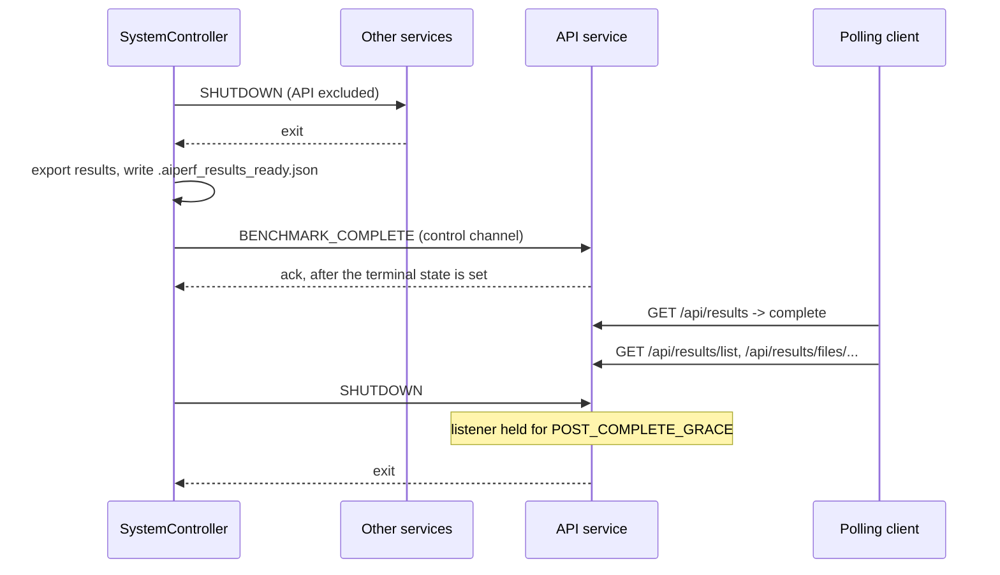

# HTTP API Endpoints

When `aiperf profile` is launched with `--api-port <PORT>` (or `AIPERF_API_SERVER_PORT` is set), AIPerf starts an in-process FastAPI server alongside the benchmark and exposes HTTP and Prometheus endpoints for the lifetime of the run. The server is opt-in — if `--api-port` is not set, no listener is created.

`--api-host` (default `127.0.0.1`) controls the bind address; pass `--api-host 0.0.0.0` to expose externally (e.g. in Kubernetes).

The router classes that back these routes live under [`src/aiperf/api/routers/`](https://github.com/ai-dynamo/aiperf/blob/main/src/aiperf/api/routers/) and are loaded via the `api_router` plugin category in [`plugins.yaml`](https://github.com/ai-dynamo/aiperf/blob/main/src/aiperf/plugin/plugins.yaml).

## Endpoints

| Method | Path | Response shape | Description |
|---|---|---|---|
| `GET` | `/api/config` | `BenchmarkConfig` | Declarative benchmark configuration for the current run. `endpoint.api_key` is excluded. Run-identity fields (`benchmark_id`, `cli_command`, etc.) live on `/api/run`, not here. |
| `GET` | `/api/run` | `RunInfo` | Run-identity metadata: `benchmark_id`, `sweep_id`, `trial`, `random_seed`, `run_label`, `variation_*`, and the redacted `cli_command`. Same shape as the `run_info` block in `profile_export_aiperf.json`. |
| `GET` | `/api/metrics` | `MetricsResponse` | Live metric values (JSON). Updated as the benchmark progresses. |
| `GET` | `/metrics` | `text/plain` | Prometheus exposition format. Scrape target for Prometheus and compatible collectors. |
| `GET` | `/api/progress` | `ProgressResponse` | Per-phase credit/request progress. |
| `GET` | `/api/workers` | `WorkersResponse` | Per-worker stats (request counts, errors, lifecycle state). |
| `GET` | `/api/results` | `BenchmarkResultsResponse` | Final benchmark results once profiling has completed. |
| `GET` | `/api/results/list` | `ResultsListResponse` | List of result artifact files under the artifact directory. |
| `GET` | `/api/results/files/{filename}` | file stream | Download an individual artifact file by relative path. |
| `GET` | `/healthz` | `text/plain` (`ok` / `unhealthy`) | Kubernetes liveness probe. 503 when the service is in `FAILED` state. |
| `GET` | `/readyz` | `text/plain` (`ok` / `not ready`) | Kubernetes readiness probe. 200 only when the service is `RUNNING`. |
| `GET` | `/docs`, `/redoc`, `/openapi.json` | (FastAPI defaults) | Auto-generated OpenAPI documentation. |

## Results lifetime

The listener outlives the benchmark itself. At the end of a run the controller stops every other service, exports the results, and commits `.aiperf_results_ready.json`. It then hands the API the run's terminal state and waits for the API to confirm it. Only after that does it retire the API. From then on the listener stays open for `AIPERF_API_SERVER_POST_COMPLETE_GRACE` seconds (default `5.0`), so a client polling `/api/results` sees `complete` (or `cancelled`) and can list and download the artifacts before the connection is refused.



- `/api/results` reports `running` until the controller's completion command arrives, even if the final metrics arrived earlier, so `complete` always means the files are on disk.
- `/api/results/list` and `/api/results/files/{filename}` withhold top-level artifacts until the ready marker commits. Checkpoint artifacts under `checkpoints/` are exempt.
- The controller waits up to `AIPERF_API_SERVER_COMPLETE_ACK_TIMEOUT` seconds (default `5.0`) for the API's confirmation. On a timeout or error it logs a warning and retires the API anyway. It also warns when the API has the terminal state but not the final metrics, in which case `/api/results` reports `incomplete` (or `cancelled`).
- `AIPERF_API_SERVER_POST_COMPLETE_GRACE=0` closes the listener right after the API confirms the terminal state. The state is always set before the listener starts closing, but a polling client may never get a request in.
- Under Kubernetes the API ignores the controller's shutdown and keeps serving until `POST /api/shutdown`.

## Breaking change: `/api/progress` `phases` keys

`ProgressResponse.phases` is keyed by each phase's concrete name (`CombinedPhaseStats.phase_name`), falling back to the plain `CreditPhase` value (e.g. `"profiling"`) only when the phase has no explicit name. Prior releases keyed this dict by the closed `CreditPhase` enum, so `progress["phases"]["profiling"]` was always a valid lookup. DAG/multi-instance phases now carry user-assigned names, so that fixed lookup can silently miss. Consumers should iterate `phases.values()` and match on each entry's `phase` field instead of indexing by a hardcoded `CreditPhase` string.

## Secret redaction

`cli_command` is captured from `sys.argv` at `BenchmarkRun` construction and redacted by [`build_cli_command()`](https://github.com/ai-dynamo/aiperf/blob/main/src/aiperf/common/redact.py) before it is stored — so the string returned from `/api/run` and written to `profile_export_aiperf.json` is the same redacted form. `--api-key`-shaped flags, credential-bearing `--header` values (e.g. `Authorization: Bearer …`), and userinfo embedded in URL-typed flags (`--url`, `-u`, `--otel-url`, `--mlflow-tracking-uri`) are all scrubbed to `<redacted>`.

`/api/config` independently excludes `endpoint.api_key` from its response.

## Example

```bash
aiperf profile --model my-model --url http://localhost:8000 \
    --api-key sk-secret-12345 --api-port 9097 --request-count 1000 &

# Inspect the redacted launch command
curl -s http://127.0.0.1:9097/api/run | jq .cli_command
# "aiperf profile --model 'my-model' --url 'http://localhost:8000' \
#  --api-key '<redacted>' --api-port 9097 --request-count 1000"

# Liveness probe
curl -s http://127.0.0.1:9097/healthz
# ok
```
