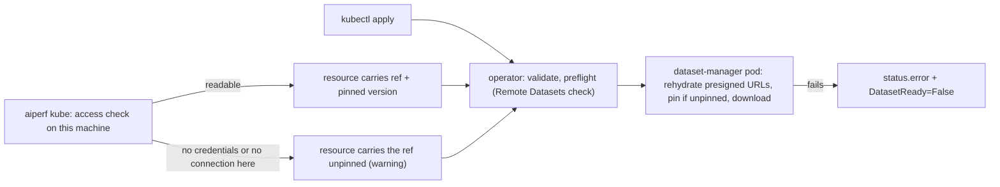

<!--
SPDX-FileCopyrightText: Copyright (c) 2026 NVIDIA CORPORATION & AFFILIATES. All rights reserved.
SPDX-License-Identifier: Apache-2.0
-->

# Run a Published Trace (Remote `--input-file`)

`--input-file` accepts a Hugging Face, S3, or HTTPS reference as well as a local path.
AIPerf checks access, pins the exact version, downloads the data into a local cache,
and then replays it exactly as it would the same file on disk.

```bash
# hf://<org>/<repo> is a placeholder; use a real published trace
aiperf profile --model my-model --url localhost:8000 --endpoint-type chat \
    --input-file hf://<org>/<repo>
```

Remote references also work on Kubernetes, through `aiperf kube` or in an
`AIPerfJob`/`AIPerfSweep` applied with `kubectl`; see [Kubernetes](#kubernetes).

To publish a trace that others can run this way, see [Publishing traces](publishing-traces.md).

---

## Reference Forms

| Source | Form | Notes |
|---|---|---|
| Hugging Face | `hf://[datasets/]<org>/<repo>[@<rev>][/<path>]` | `<rev>` is a branch, tag, or commit; URL-encode slashes (`refs%2Fpr%2F1`). Only dataset repos are supported. |
| S3 | `s3://<bucket>/<key>[?versionId=<id>]` | A key ending in `/` is a prefix, and so is a key that is not an object. Needs `uv pip install 'aiperf[aws]'`. |
| HTTP(S) | `https://...` (or `http://...`) | One file. Presigned S3/GCS URLs work. |

A reference to a **file** runs as is. A reference to a **repo, folder, or prefix** needs an
`aiperf.json` manifest at its root that names the data file and its format; see
[Publishing traces](publishing-traces.md). A single file can also have an optional
`<file>.aiperf.json` sidecar next to it, which supplies the format and other defaults
(HTTPS sidecars are only looked up for URLs without a query string).

Other schemes are rejected when the command line is parsed, and the error lists the supported
ones.

```bash
# A single file in a Hugging Face repo, pinned to a commit
aiperf profile ... --input-file hf://datasets/<org>/<repo>@<commit>/data/chat.jsonl.gz \
    --custom-dataset-type mooncake_trace

# An S3 prefix that holds an aiperf.json
aiperf profile ... --input-file s3://my-traces/chat/2026-08/

# A presigned URL
aiperf profile ... --input-file "https://my-bucket.s3.amazonaws.com/chat.jsonl.gz?X-Amz-Signature=..." \
    --custom-dataset-type mooncake_trace
```

`--custom-dataset-type` is optional when a manifest or sidecar declares the format. If you
pass both and they disagree, the run fails before anything is downloaded.

---

## Parquet Datasets

Parquet files and directories of parquet shards work wherever JSONL does, for the formats
that read their records through the shared reader: `mooncake_trace`, `bailian_trace`,
`single_turn`, `multi_turn`, the `speed_bench_*` formats, and `baseten_trace` (a single file
only; a directory of Baseten shards is rejected). Any other format fails before the run with
"does not read parquet files"; convert the data to JSONL or choose a format that reads parquet.

- Rows are read as JSON records and nulls are dropped, which restores the record shape of the
  JSONL file that `datasets.push_to_hub` started from. Binary, timestamp, decimal, and map
  columns, and NaN or infinity values, are rejected with the name of the column.
- A directory reads every shard in order. When the shards are named
  `<split>-00000-of-00002.parquet` and several splits are present, AIPerf reads `train`.
- Files beside the shards that are not data are skipped: READMEs, `aiperf.json` manifests, and
  names starting with `.` or `_`. That covers the `_SUCCESS`, `_committed_*`, `_metadata`, and
  `.crc` files that Spark and Hive write, so their output folders work as-is, on S3 or locally.
- `pyarrow` ships with AIPerf on every platform except Windows on ARM, which has no wheel. There
  a remote parquet source fails before anything is downloaded.

A Hugging Face repo with **no `aiperf.json`** also runs when it uses the layout that
`datasets.push_to_hub` writes, or the one on the `refs/convert/parquet` branch:

```bash
# A config folder (the only folder holding parquet, or one that has a train split)
aiperf profile ... --input-file hf://datasets/<org>/<repo>/<config> \
    --custom-dataset-type mooncake_trace

# The auto-converted parquet branch of any dataset (URL-encode the slashes in the branch)
aiperf profile ... --input-file "hf://datasets/<org>/<repo>@refs%2Fconvert%2Fparquet/<config>/train" \
    --custom-dataset-type mooncake_trace

# A single shard file
aiperf profile ... --input-file hf://datasets/<org>/<repo>/<config>/train-00000-of-00001.parquet \
    --custom-dataset-type mooncake_trace
```

Without a manifest, AIPerf picks the data as follows:

1. It descends into the only folder that holds parquet, or into `train` when several folders do.
2. In a folder of shards it reads the `train` split. When other splits are dropped, the run log
   says so at INFO level.
3. If a folder holds several datasets and none is named `train`, the run fails with "has
   several datasets under ..." and the hint `Use one of: ...` lists a ready-to-use reference
   for each. If a folder holds shards of several splits and none is named `train`, the run fails
   with "holds the splits ..." and the hint `Use one split's shard, e.g. ...` lists a reference
   to one shard of each split.

A manifest's `path` can also name a folder of parquet shards on Hugging Face or S3. The same
`train` split rule applies, and several splits with no `train` fail at the access check, before
anything is downloaded. On Hugging Face only the chosen split's shards are downloaded. On S3 the
whole prefix is downloaded, and the reader then picks the same split from the local copy. For an
S3 manifest folder the split error reads "its manifest folder ... holds the splits ... and none
is named 'train'", and its hint asks the publisher to keep one split in the folder or to name it
`train`.

A manifest-less remote parquet source replays on its recorded timestamp schedule only when
`--custom-dataset-type` names a trace format. To also declare the format, add `aiperf.json`;
see [Publishing traces](publishing-traces.md#publishing-with-datasetspush_to_hub).

---

## What Happens Before the Run

1. **Access check.** AIPerf checks that the source exists, that your credentials work, and
   that the manifest (if any) is valid and compatible with the run: the format must exist in
   this AIPerf, the `requires.aiperf` version specifier and `requires.endpoint_types` must be
   satisfied. It pins the exact version here (Hugging Face commit SHA, S3 object version or
   ETag, HTTP `ETag` or, without one, `Last-Modified` and length). Problems fail at this step, before anything is downloaded, including a
   parquet source whose declared format does not read parquet. The one exception is a parquet
   source that needs the first-record check (a trace format declared by flag or manifest, and
   neither `--fixed-schedule` nor `--no-fixed-schedule`): a single parquet file is downloaded
   here, and a parquet folder has its first shard downloaded, so that its first row can be
   read (step 2).
2. **First-record check.** For trace formats, AIPerf reads the first record. If it has
   timestamps, the run replays on the recorded schedule (`--no-fixed-schedule` opts out), just
   like a local trace. To decide this it reads only the leading bytes of the file, in steps of
   64 KiB, 1 MiB, and 8 MiB, and downloads the whole file only when the first record is longer
   than that. A single columnar file (Parquet, Arrow) is read from the downloaded copy, since
   its schema sits at the end of the file. A parquet folder is read from its first shard only,
   fetched into the cache so the full download in step 3 reuses it.
3. **Download** into the cache, verified against the manifest's `sha256` when present. The
   first record is then checked against the chosen format, so a file that does not look like
   its declared format fails with a clear error instead of during the run.

Options that conflict with a fixed schedule (a request rate, a non-sequential
`--dataset-sampling-strategy`, a parameter sweep) behave as they do for a local file: the
trace is not promoted, and the run fails with the conflict only if the trace turns out to have
timestamps.

A remote `dag_jsonl` file cannot be counted before it is downloaded, so it needs an explicit
stop condition (`--conversation-num`, `--request-count`, or `--benchmark-duration`).

The run log prints the exact version used, for example:

```text
Remote dataset hf://<org>/<repo>: using hf://datasets/<org>/<repo>@3e1f.../data/chat.jsonl.gz (version 3e1f..., 1 file(s), 48211093 bytes, sha256 9c1d4f0a7b2e)
```

Copy the `using ...` reference to reproduce the run. The same information (reference, pinned
version, downloaded files with their digests, and the manifest digest) is recorded under
`metadata.dataset` in `profile_export_aiperf.json`.

---

## Credentials

| Source | How |
|---|---|
| Hugging Face | `HF_TOKEN`, or `hf auth login`. Gated repos also need their terms accepted on the dataset page. |
| S3 | The standard AWS credential chain: environment variables, `~/.aws`, `aws sso login`, or an instance/pod role. `AWS_ENDPOINT_URL_S3` targets MinIO, Ceph, or R2. |
| HTTPS | None; presigned URLs carry their own. |

Presigned URLs are redacted everywhere AIPerf writes them: logs, error messages,
`run_config.json`, the command line recorded in `profile_export_aiperf.json`, and the
provenance above. A presigned URL that has expired fails with an access-denied error that
suggests generating a new one.

---

## Pinning, Caching, and Offline Runs

- Unpinned references check for a newer version on every run and download only when it changed.
  Pin with `@<commit>` (Hugging Face) or `?versionId=` (S3) for comparable results. An HTTPS URL
  is versioned by its `ETag` (or `Last-Modified` and length); a server that sends neither is
  downloaded again on every run, with a warning.
- Hugging Face files use the standard Hugging Face cache (`HF_HOME`). S3 and HTTPS files go to
  `~/.cache/aiperf/remote` (`AIPERF_DATASET_REMOTE_CACHE_DIR`). Nothing is evicted
  automatically; delete the directory to reclaim disk.
- If another AIPerf process is downloading the same version, the run waits for it. If no other
  run is active, delete the lock file named in the error and retry.
- `AIPERF_DATASET_REMOTE_OFFLINE=1` (or `HF_HUB_OFFLINE=1`) makes AIPerf use only what it has
  already downloaded and never touch the network. An unpinned reference uses the newest cached
  version, and a warning says so. A reference AIPerf has not downloaded before fails with a
  not-found error.
- An interrupted download never leaves a partial file behind, so the next run downloads
  again instead of serving a truncated copy. S3 and HTTPS downloads stop promptly on Ctrl-C.
  Ctrl-C during an `hf://` download waits for the file currently downloading to finish, because
  the Hugging Face client is not interrupted mid-file.
- Transient failures (timeouts, HTTP 429 and 5xx) are retried automatically, three attempts in
  total with a growing delay. If the remote changes after AIPerf pinned it (a force-pushed
  repo, a replaced object), the run fails with a "changed after AIPerf pinned its version"
  error; run again to use the new version.

## Kubernetes

`aiperf kube profile`, `aiperf kube generate` and `aiperf kube sweep` accept the same
references, and so do `AIPerfJob` and `AIPerfSweep` resources applied with `kubectl`. Only the
dataset-manager container downloads; workers receive the built dataset as before.



### Pinning

- `aiperf kube` runs the access check on the machine you run it from, pins the version, and
  writes `path: {ref: ..., resolved_version: ...}` into the resource. Every pod, and every
  child of an `aiperf kube sweep`, uses that version.
- If this machine cannot read an `hf://` or `s3://` source but the pods can (IRSA, EKS Pod
  Identity, a token only the pods have), the reference is submitted unpinned with a warning,
  and the dataset-manager pod pins it when it starts. An `https://` source that refuses this
  machine fails instead, because the pod would fetch the same URL.
- If this machine cannot connect to the source at all (a DNS failure, a refused connection, a
  timeout), for example an object store or HTTP server that only the cluster's network reaches,
  the reference is submitted unpinned with the same warning, whatever its scheme. An HTTP 429 or
  5xx answer is not a connection failure: the source answered, so `aiperf kube` retries and then
  fails.
- A trace whose fixed-schedule promotion depends on its first record cannot be submitted
  unpinned. Pass `--fixed-schedule` or `--no-fixed-schedule`, or run `aiperf kube` from a
  machine that can read the source.
- A resource applied with `kubectl` is pinned by its dataset-manager pod. An unpinned
  `AIPerfSweep` applied with `kubectl` resolves the reference separately in each child, so
  children can see different versions. Pin explicitly (`@<commit>`, `?versionId=`) or use
  `aiperf kube sweep`.
- When the pod pins, the pinned version and any manifest defaults (`format`, `block_size`)
  exist only in the dataset-manager's copy of the run, and `profile_export_aiperf.json` records
  the reference without its version. Pin on the CLI host, or in the reference, when you need
  full provenance.

### Credentials

| Source | What the pods need |
|---|---|
| Hugging Face (private or gated) | `--env-from-secrets HF_TOKEN=<secret>/<key>`, or an `HF_TOKEN_PATH` env pointing at a mounted Secret file. A missing token fails before submission. |
| S3 | An AWS identity: a ServiceAccount with IRSA or EKS Pod Identity (`--service-account`), or `AWS_*` env from a Secret. IRSA and node roles are invisible in the pod spec, so a non-public object with neither only warns. |
| HTTPS presigned URL | The full URL in a Secret, passed as `AIPERF_INJECTED_DATASET_URLS` (below). |

A presigned URL is a credential. The resource, the run ConfigMap and every spec the operator
stores carry it with its signature replaced by `<redacted>`. Put the full URL(s) in a Secret as
a JSON list and pass it to the pods; AIPerf never creates the Secret:

```bash
kubectl create secret generic aiperf-dataset-urls -n <namespace> \
    --from-literal=urls='["https://bucket.s3.amazonaws.com/trace.jsonl?X-Amz-Signature=..."]'

aiperf kube profile ... \
    --input-file 'https://bucket.s3.amazonaws.com/trace.jsonl?X-Amz-Signature=...' \
    --env-from-secrets AIPERF_INJECTED_DATASET_URLS=aiperf-dataset-urls/urls
```

The dataset-manager pod matches each URL to its dataset by the URL without its signing
parameters. A resource applied with `kubectl` must not contain the signature: the operator
rejects it, because the API server has already stored it, so rotate the URL. Write the path
as `aiperf kube generate --operator` does, with the credential values replaced by
`<redacted>`. `aiperf kube validate` catches a raw signature before you apply.

Before submission, `aiperf kube` warns when a presigned URL expires within an hour (queueing,
for example in Kueue, can delay the download) and fails when it has already expired. The
operator runs the same checks for resources applied with `kubectl`; see
[Preflight](../kubernetes/preflight.md#remote-datasets-operator-and-cli).

### Storage

- Hugging Face files land in the pod's Hugging Face home (`/aiperf/hf_home`, an emptyDir;
  AIPerf sets `HF_HOME` and ignores a user value). S3 and HTTPS files land in
  `/aiperf/remote-cache`, an emptyDir mounted in the dataset-manager and control-plane
  containers.
- Both use the node's ephemeral storage. For multi-GB datasets, or to reuse downloads across
  jobs, mount a PVC and point `HF_HUB_CACHE` and `AIPERF_DATASET_REMOTE_CACHE_DIR` at paths on
  it; see [Kubernetes configuration](../kubernetes/configuration.md#remote-datasets).

### Large datasets and the startup probe

The dataset-manager downloads before its health server starts, so its startup probe fails for
as long as the download runs. With the defaults the probe allows about 150 seconds
(`AIPERF_K8S_HEALTH_STARTUP_FAILURE_THRESHOLD=30` checks, one every
`AIPERF_K8S_HEALTH_STARTUP_PERIOD_SECONDS=5`), after which the kubelet kills the container,
possibly in the middle of a multi-GB download and before AIPerf can write its termination
message. The job then fails without the `[dataset-manager pod]` line or the `DatasetReady`
condition described below.

For large datasets, raise `AIPERF_K8S_HEALTH_STARTUP_FAILURE_THRESHOLD` (at most 120), or
pre-populate a PVC-backed cache (see Storage) so the pod finds the files already downloaded.
These variables are read by the process that renders the JobSet, so set them on the operator
Deployment, not in `spec.podTemplate.env`; see
[Kubernetes configuration](../kubernetes/configuration.md#health-probes).

### When the pod fails

A dataset that fails in the pod stops the dataset-manager before the benchmark starts. The job
fails with a `status.error` that contains `[dataset-manager pod] Cannot use <reference>: ...`,
the `DatasetReady` condition turns `False` with reason `DatasetUnavailable`, and
`aiperf kube debug --job-id <name>` shows both. Gated public datasets (`--public-dataset`)
fail the same way.

---

## Troubleshooting

Errors read `Cannot use <reference>: <what went wrong>. <how to fix it>.` Find your message
in the table.

| The message says | Typical cause | Fix |
|---|---|---|
| "requires authentication (HTTP 401)", "was not found; it may be private", or "no usable AWS credentials" | A private repo or object and no credentials | Set `HF_TOKEN` / run `hf auth login`, or configure AWS credentials |
| "the AWS credentials are expired or invalid" | Expired AWS session | Refresh them (for example `aws sso login`) |
| "denied access" or "S3 denied access" | The token or IAM role lacks permission, or an HTTPS presigned URL expired | Check permissions, or generate a new presigned URL. Without `s3:ListBucket`, S3 also answers this for a key that does not exist |
| "has not accepted its terms" | A gated Hugging Face dataset | Accept the terms on the dataset page, then retry |
| "has no revision" or "has no version" | The `@<rev>` or `?versionId=` does not exist | Check the branch, tag, commit, or version id |
| "was not found, or your token can't access it", "S3 has no such bucket or key", or "the server has no such file" | Wrong repo, path, key, or URL | Check the reference |
| "offline mode is on and it is not in the local cache" | Offline mode with nothing downloaded for that reference | Run once with network access, or unset `AIPERF_DATASET_REMOTE_OFFLINE` / `HF_HUB_OFFLINE` |
| "no `aiperf.json` describing it" or "no `aiperf.json` under it" | A repo, folder, or prefix without a manifest | Point at a data file, or ask the publisher to add `aiperf.json` |
| "its manifest points at" ... "which does not exist", or "its manifest" ... "is invalid" | A malformed or stale manifest | Ask the publisher to fix `aiperf.json` |
| "under the data prefix cannot be stored as a local file" | An S3 key under the prefix contains `..`, `.`, an empty segment, or a backslash, or (on Windows) a colon or drive letter | Ask the publisher to rename that object |
| "it requires AIPerf", "newer than this AIPerf supports", or "does not have" | The manifest needs a newer AIPerf | Upgrade AIPerf |
| "it supports --endpoint-type" | The manifest limits the endpoint types | Pass a supported `--endpoint-type` |
| "its manifest declares format" or "conflicts with this run's dataset options" | The manifest disagrees with your flags | Drop the conflicting option, or pass the manifest's format |
| "its first record does not look like" | The file is not in the declared format | Check the manifest's format, or pass the right `--custom-dataset-type` |
| "has several datasets under" | A manifest-less Hugging Face repo with parquet in several folders, none named `train` | Use one of the references the error lists |
| "holds the splits" or "hold the splits" | A parquet folder (Hugging Face, S3 manifest folder, or local directory) with several splits and none named `train` | Point at one split's folder or shard, as the error suggests |
| "does not read parquet files" | A parquet source with a format that only reads JSONL | Convert the data to JSONL, or choose a format that reads parquet |
| "parquet datasets need pyarrow" | `pyarrow` is missing; it is installed everywhere except Windows on ARM, which has no wheel | Run on another platform, or convert the data to JSONL |
| "which AIPerf records cannot hold" | A parquet column of binary, timestamp, decimal, or map type, or a NaN or infinity value | Convert that column to a supported type; the message names it |
| "the downloaded file's sha256 is" | The file does not match the manifest's `sha256` | Retry; if it persists, the publisher's file or manifest is wrong |
| "changed after AIPerf pinned its version" | The remote changed during the run | Run again to use the new version |
| "need the optional botocore dependency" | `s3://` without the AWS extra | `uv pip install 'aiperf[aws]'` |
| "so AIPerf cannot tell whether the trace has timestamps" | `aiperf kube` could not read the source, and the phase type depends on its first record | Pass `--fixed-schedule` or `--no-fixed-schedule`, or run from a machine that can read the source |
| "is private or gated, and the pods have no Secret-backed HF_TOKEN" | A Hugging Face repo that needs a token, submitted without one | `--env-from-secrets HF_TOKEN=<secret>/<key>` |
| "must come from Secret-backed pod environment variables" naming `AIPERF_INJECTED_DATASET_URLS` | A presigned dataset URL with no Secret for the pods | Create the Secret and pass `--env-from-secrets AIPERF_INJECTED_DATASET_URLS=<secret>/<key>` |
| "carries a credential (a presigned query or URL userinfo) in the resource itself" | A `kubectl`-applied resource holding a raw presigned URL | Rotate the URL, move it into a Secret, and write the path with `<redacted>` values |
| "has no URL for it" or "matches no dataset in this run" | The Secret's URL list does not name the dataset in the resource | Make the Secret hold the full URL of exactly that dataset |
| "The presigned URL ... expired at" | The URL expired before submission | Generate a new URL and update the Secret |
| `status.error` contains `[dataset-manager pod]` | The dataset failed inside the pod | Look up the rest of the message in this table |
| "cannot be written" | The cache directory is full or read-only | Free disk space or fix permissions, or set `AIPERF_DATASET_REMOTE_CACHE_DIR` (Hugging Face: `HF_HOME`) |
| "the connection failed", "is unavailable", or "could not be reached" | Network trouble or a rate-limited server | Check network access and retry later |
| "timed out waiting for another process" | Another AIPerf run holds the download lock | Wait, or delete the lock file the message names if no run is active |

If the manifest declares `requires.max_context_tokens`, AIPerf only warns when it is larger
than `--max-context-length`. That comparison happens only when `--max-context-length` is set,
and that option applies to formats that implement context filtering, which today is Weka. It
never fails the run.
